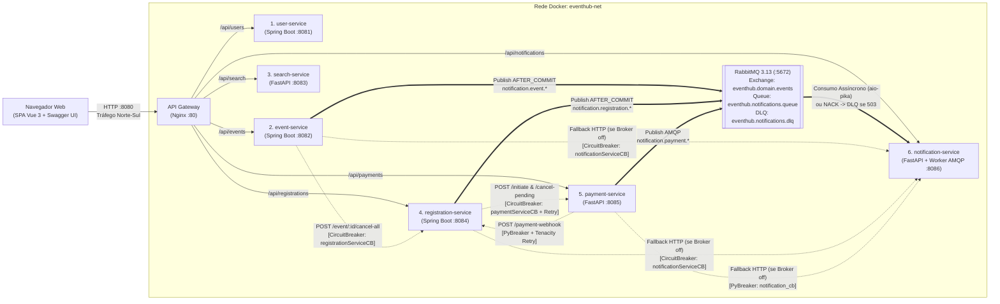

# API Gateway (Nginx), Mensageria Assíncrona e Integração entre Microsserviços — EventHub

Este documento explica como o **API Gateway** ([infra/gateway/nginx.conf](infra/gateway/nginx.conf)) é utilizado no **EventHub** para integrar a aplicação web SPA ([web-app/index.html](web-app/index.html)) e o portal OpenAPI ([web-app/swagger.html](web-app/swagger.html)) aos 6 microsserviços de negócio, bem como a separação entre o tráfego externo (**Norte–Sul**) e a comunicação interna entre serviços (**Leste–Oeste**), que combina **chamadas REST protegidas por Circuit Breaker Formal (Resilience4j / PyBreaker + Tenacity)** e **Publish/Subscribe Assíncrono via RabbitMQ com Dead Letter Queue (DLQ)**.

---

## 1. Papel Arquitetural do API Gateway

No [docker-compose.yml](docker-compose.yml), o container `eventhub-gateway` (**Nginx 1.27 Alpine**) é o **único ponto de entrada HTTP exposto na máquina hospedeira** (porta `8080`). Os 6 microsserviços (`user-service`, `event-service`, `search-service`, `registration-service`, `payment-service` e `notification-service`) não expõem portas diretamente no host e operam isolados dentro da rede bridge interna `eventhub-net`.

Suas responsabilidades principais são:

1. **Entrega da Aplicação Web (SPA) e do Portal Swagger na mesma origem (`http://localhost:8080`)**, eliminando problemas de *CORS* (*Cross-Origin Resource Sharing*) no navegador.
2. **Roteamento Reverso por Prefixo de Caminho (`/api/*`)** para os respectivos microsserviços Java (Spring Boot) e Python (FastAPI).
3. **Resolução DNS Dinâmica e Degradação Graciosa (`RQ03`, `RQ08`)**, devolvendo respostas JSON padronizadas (`HTTP 503`) caso um microsserviço esteja fora do ar ou ainda inicializando.
4. **Segurança de Borda (`RN07`, `RQ07`)**, repassando o cabeçalho `Authorization: Bearer <JWT>` aos serviços e bloqueando na borda (`HTTP 404`) endpoints exclusivos de comunicação interna entre microsserviços.
5. **Observabilidade e Rastreabilidade (`RQ06`)**, injetando e retornando `X-Correlation-ID` em todas as chamadas e registrando métricas de latência (`rt`, `uct`, `urt`) em log estruturado.

---

## 2. Diagrama de Integração (Norte–Sul vs. Leste–Oeste com Circuit Breaker e Pub/Sub RabbitMQ)



- **Linhas contínuas (Tráfego Norte–Sul):** Requisições originadas na SPA ([web-app/js/api.js](web-app/js/api.js)), no laboratório ([web-app/js/lab-runner.js](web-app/js/lab-runner.js)) ou no Swagger UI ([web-app/swagger.html](web-app/swagger.html)) passam obrigatoriamente pelo API Gateway em `http://localhost:8080`.
- **Setas duplas (Tráfego Leste–Oeste Assíncrono — Publish/Subscribe via RabbitMQ):** Os microsserviços `event-service`, `registration-service` (em fase `AFTER_COMMIT`, fora do lock pessimista) e `payment-service` publicam eventos de domínio na Topic Exchange `eventhub.domain.events` do container `eventhub-rabbitmq`. O `notification-service` consome a fila `eventhub.notifications.queue` assincronamente via `aio-pika` e, caso esteja em modo de falha simulada (`RN05`), rejeita a mensagem (`requeue=False`) encaminhando-a para a **Dead Letter Queue (`eventhub.notifications.dlq`)** sem perda de dados.
- **Linhas tracejadas (Tráfego Leste–Oeste Síncrono Protegido por Circuit Breaker):** Chamadas REST síncronas entre microsserviços utilizam o DNS interno do Docker (`http://<nome-do-servico>:<porta>`) protegidas por **Resilience4j** (nos serviços Java) e **PyBreaker + Tenacity** (no `payment-service`), incluindo fallback automático Dual-Mode para HTTP caso o broker RabbitMQ esteja inacessível.

---

## 3. Tabela de Roteamento Reverso (`/api/*`)

| Prefixo no Gateway (`:8080`) | Upstream Interno (`eventhub-net`) | Serviço | Stack | Fallback de Indisponibilidade (`502/503/504`) |
|---|---|---|---|---|
| `/health` | *(Respondido pelo próprio Nginx)* | `api-gateway` | Nginx 1.27 | `200 {"status":"UP","component":"api-gateway"}` |
| `/api/users` | `http://user-service:8081` | `user-service` | Java 21 / Spring Boot 3 | `@service_unavailable_users` (`HTTP 503` JSON) |
| `/api/events` | `http://event-service:8082` | `event-service` | Java 21 / Spring Boot 3 | `@service_unavailable_events` (`HTTP 503` JSON) |
| `/api/search` | `http://search-service:8083` | `search-service` | Python 3.12 / FastAPI | `@service_unavailable_search` (`HTTP 503` JSON) |
| `/api/registrations` | `http://registration-service:8084` | `registration-service` | Java 21 / Spring Boot 3 | `@service_unavailable_registrations` (`HTTP 503` JSON) |
| `/api/payments` | `http://payment-service:8085` | `payment-service` | Python 3.12 / FastAPI | `@service_unavailable_payments` (`HTTP 503` JSON) |
| `/api/notifications` | `http://notification-service:8086` | `notification-service` | Python 3.12 / FastAPI | `@service_unavailable_notifications` (`HTTP 503` JSON) |
| `/` | `/usr/share/nginx/html` | SPA Web & Swagger | Vue 3 + Tailwind / DaisyUI | `try_files $uri $uri/ /index.html` |

---

## 4. Mecanismos Técnicos Configurados no `nginx.conf`

### 4.1. Resolução DNS Dinâmica e Subida Independente (`RQ01`, `RQ03`, `RQ08`)
```nginx
resolver 127.0.0.11 valid=10s ipv6=off;
```
Ao usar o resolvedor DNS embutido do Docker (`127.0.0.11`) combinado com variáveis nos blocos `location` (ex.: `set $event_upstream http://event-service:8082; proxy_pass $event_upstream;`), o Nginx não falha na partida caso algum microsserviço ainda esteja compilando ou seja reiniciado individualmente.

### 4.2. Interceptação de Erros e Resposta JSON Amigável (`RQ03`)
Quando um container de microsserviço é parado (por exemplo, `docker compose stop search-service`), o Nginx intercepta os erros `502 Bad Gateway`, `503 Service Unavailable` e `504 Gateway Timeout` (`proxy_intercept_errors on;`) e devolve um payload JSON estruturado:
```json
{
  "status": "DOWN",
  "service": "search-service",
  "stack": "Python 3.12 / FastAPI",
  "message": "Serviço de Busca ainda não iniciado ou indisponível."
}
```
Isso permite que o cliente HTTP da SPA ([web-app/js/api.js](web-app/js/api.js)) e o painel **Status dos Serviços** tratem a indisponibilidade sem quebrar a interface.

### 4.3. Repasse de JWT e Isolamento de Endpoints Internos (`RN07`, `RQ07`)
- **Propagação do Token JWT:**
  ```nginx
  proxy_set_header Authorization $http_authorization;
  ```
  O token JWT obtido em `POST /api/users/login` é armazenado pela SPA e enviado no cabeçalho `Authorization: Bearer <token>`. O gateway repassa esse cabeçalho integralmente aos microsserviços Java (`JwtAuthFilter`) e Python (`auth.py`), que validam a assinatura HMAC (`JWT_SECRET`), o `userId` e a `role` (`ORGANIZER` ou `PARTICIPANT`).
- **Bloqueio de Endpoints Internos na Borda:**
  Endpoints que compõem a orquestração interna entre serviços são explicitamente bloqueados no gateway para chamadas vindas de fora da rede Docker:
  - `POST /api/registrations/payment-webhook` $\rightarrow$ `404 {"status":"NOT_FOUND","message":"Endpoint interno."}`
  - `POST /api/payments/initiate` $\rightarrow$ `404 {"status":"NOT_FOUND","message":"Endpoint interno."}`
  - `POST /api/payments/registration/{id}/cancel-pending` $\rightarrow$ `404 {"status":"NOT_FOUND","message":"Endpoint interno."}`

### 4.4. Correlação de Requisições e Logs de Latência (`RQ06`)
```nginx
log_format eventhub_log '$remote_addr - [$time_local] "$request" '
                        'status=$status bytes=$body_bytes_sent '
                        'rt=$request_time uct="$upstream_connect_time" urt="$upstream_response_time"';

proxy_set_header X-Correlation-ID $request_id;
add_header X-Correlation-ID $request_id always;
```
Cada requisição recebe um identificador único (`$request_id`) propagado aos microsserviços e devolvido ao navegador no cabeçalho `X-Correlation-ID`, permitindo rastrear chamadas ponta a ponta e auditar o tempo de resposta de cada upstream.

---

## 5. Como a Aplicação Web (SPA) Consome o Gateway

---

## 6. Resiliência Leste–Oeste: Publish/Subscribe (RabbitMQ + DLQ) e Circuit Breaker Formal

Enquanto o **API Gateway (Nginx)** protege a borda Norte–Sul contra indisponibilidade de containers (`502/503/504`), a comunicação interna **Leste–Oeste** conta com duas camadas complementares de resiliência:

### 6.1. Mensageria Assíncrona Publish/Subscribe (`eventhub-rabbitmq`)
- **Exchange de Eventos de Domínio:** `eventhub.domain.events` (`topic`, `durable=true`).
- **Fila de Consumo:** `eventhub.notifications.queue` (`durable=true`), vinculada às routing keys `notification.#`, `event.#`, `registration.#` e `payment.#`.
- **Dead Letter Exchange e Dead Letter Queue:** `eventhub.domain.dlx` $\rightarrow$ `eventhub.notifications.dlq` (`durable=true`).
- **Publicação Pós-Commit (`AFTER_COMMIT`):**
  - No `registration-service` ([ExternalIntegrationService.java](services/registration-service/src/main/java/com/eventhub/registration/service/ExternalIntegrationService.java)) e no `event-service` ([NotificationClient.java](services/event-service/src/main/java/com/eventhub/event/service/NotificationClient.java)), o envio de notificações é agendado via `TransactionSynchronization.afterCommit()`. Isso garante que o lock pessimista `SELECT ... FOR UPDATE` no PostgreSQL seja liberado imediatamente no commit da transação local, sem reter locks durante I/O de rede.
- **Comportamento sob Simulação de Falha (`RN05` / `RQ03`):**
  - Quando `POST /api/notifications/simulate-failure?fail=true` está ativo, o worker `aio-pika` ([amqp_consumer.py](services/notification-service/app/services/amqp_consumer.py)) rejeita a mensagem (`requeue=False`) e o RabbitMQ a transfere automaticamente para a fila `eventhub.notifications.dlq`, evitando perda de notificações sem impactar os fluxos principais.

### 6.2. Circuit Breaker Formal e Retry com Backoff (Resilience4j e PyBreaker)

| Serviço Origem | Serviço Destino | Componente / Classe | Instância de Circuit Breaker / Retry | Comportamento de Fallback / Abertura |
|---|---|---|---|---|
| `registration-service` (Java) | `payment-service` (Python) | [ExternalIntegrationService.java](services/registration-service/src/main/java/com/eventhub/registration/service/ExternalIntegrationService.java) | `@CircuitBreaker(name = "paymentServiceCB")` + `@Retry(name = "paymentServiceRetry")` | Faz até 2 tentativas (intervalo de `250ms`); com circuito `OPEN`, falha em $< 1\text{ms}$ e aciona a compensação `releaseAfterPaymentFailure` da reserva. |
| `registration-service` (Java) | `notification-service` (Python) | [NotificationHttpFallbackClient.java](services/registration-service/src/main/java/com/eventhub/registration/service/NotificationHttpFallbackClient.java) | `@CircuitBreaker(name = "notificationServiceCB")` | Acionado caso o broker RabbitMQ esteja indisponível; abre após 50% de falhas em 6 chamadas (mínimo 3) e suprime o erro em $< 1\text{ms}$ (`RN05`). |
| `event-service` (Java) | `registration-service` (Java) | [RegistrationIntegrationClient.java](services/event-service/src/main/java/com/eventhub/event/service/RegistrationIntegrationClient.java) | `@CircuitBreaker(name = "registrationServiceCB")` | Protege `POST /api/registrations/event/{id}/cancel-all`; quando `OPEN` ou em falha, executa imediatamente o fallback SQL local via `JdbcTemplate`. |
| `event-service` (Java) | `notification-service` (Python) | [NotificationHttpFallbackClient.java](services/event-service/src/main/java/com/eventhub/event/service/NotificationHttpFallbackClient.java) | `@CircuitBreaker(name = "notificationServiceCB")` | Protege o fallback HTTP em atualizações/cancelamentos de eventos e emissão de certificados (`RN05`). |
| `payment-service` (Python) | `registration-service` (Java) | [downstream_client.py](services/payment-service/app/services/downstream_client.py) | `pybreaker.CircuitBreaker("registration_webhook_cb")` + `tenacity.retry` | Realiza até 2 tentativas com backoff exponencial (`0.1s`–`0.3s`) ao chamar `/payment-webhook`; se falhar ou circuito abrir (`fail_max=4`), reverte o pagamento (`HTTP 424`). |
| `payment-service` (Python) | `notification-service` (Python) | [downstream_client.py](services/payment-service/app/services/downstream_client.py) | `pybreaker.CircuitBreaker("notification_cb")` | Protege o fallback HTTP caso a publicação AMQP via `pika` não esteja disponível (`fail_max=3`, `reset_timeout=15s`). |

No arquivo [web-app/js/api.js](web-app/js/api.js), todas as chamadas utilizam caminhos relativos à mesma origem do gateway (`/api/...`), anexando automaticamente o token JWT da sessão e medindo a latência e o `X-Correlation-ID` devolvidos pelo Nginx:

1. **Autenticação e Perfil (`user-service`):** `POST /api/users/login`, `POST /api/users/register`, `GET /api/users/me`, `PUT /api/users/me`, `GET /api/users/{id}`.
2. **Gestão de Eventos, Programação, Check-in e Certificados (`event-service`):** `GET/POST/PUT /api/events`, `PATCH /api/events/{id}/publish|cancel`, `POST/PUT /api/events/.../activities`, `POST /api/events/attendance/check-in`, `POST /api/events/certificates/issue`, `GET /api/events/certificates/my`, `GET /api/events/certificates/validate/{code}`.
3. **Catálogo Público e Busca (`search-service`):** `GET /api/search/events` e `GET /api/search/activities` (com filtros `keyword`, `organization`, `onlyFree`, `onlyAvailable`).
4. **Inscrições, Fila de Espera e Relatórios (`registration-service`):** `POST /api/registrations`, `GET /api/registrations/my`, `GET /api/registrations/{id}`, `PATCH /api/registrations/{id}/cancel`, `GET /api/registrations/reports/event/{eventId}`.
5. **Checkout Simulado (`payment-service`):** `GET /api/payments/registration/{registrationId}`, `POST /api/payments/{paymentId}/confirm|refuse|expire`.
6. **Central de Notificações e Simulação de Falha (`notification-service`):** `GET /api/notifications/user/{userId}`, `PATCH /api/notifications/{id}/read`, `DELETE /api/notifications/{id}`, `POST /api/notifications/simulate-failure`.
