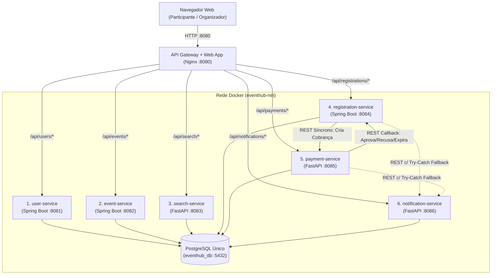

# Plano de Projeto e Implementação em "Baby Steps" — EventHub Microsserviços

Este documento apresenta o plano arquitetural e o roteiro de implementação incremental (*baby steps* autocontidos) para a plataforma web **EventHub**, atendendo integralmente à especificação de [Trabalho_2_EventHub_Microsservicos.docx](Trabalho_2_EventHub_Microsservicos.docx) e à decomposição de serviços candidatos definida em [Microsservicos.txt](Microsservicos.txt).

---

## 1. Visão Geral e Decomposição dos Microsserviços

Conforme definido em [Microsservicos.txt](Microsservicos.txt), o sistema é composto por **6 microsserviços de domínio**, distribuídos de forma equilibrada entre **Java 21 / Spring Boot 3** e **Python 3.12 / FastAPI**, compartilhando uma instância única do banco de dados **PostgreSQL 16** embarcada em container Docker, além de um **API Gateway + Aplicação Web** unificados.

| # | Microsserviço | Diretório | Stack Tecnológica | Porta Interna | Requisitos Funcionais e Regras de Negócio |
|---|---|---|---|---|---|
| 1 | **Serviço de Usuários/Perfis** | `services/user-service` | Java 21 + Spring Boot 3 | `8081` | **RF01, RN07, RQ07**: Cadastro, autenticação (JWT), manutenção de perfis e diferenciação de permissões (`PARTICIPANT` vs. `ORGANIZER`). |
| 2 | **Serviço de Eventos e Programações** | `services/event-service` | Java 21 + Spring Boot 3 | `8082` | **RF02, RF03, RF09, RF10, RN06**: Criação, edição, publicação e cancelamento de eventos; cadastro de atividades (horários, vagas, preço, lista de espera); registro de presença (*check-in*) e emissão de certificados. |
| 3 | **Serviço de Busca** | `services/search-service` | Python 3.12 + FastAPI | `8083` | **RF04, RQ02**: Consulta otimizada de eventos publicados, programação detalhada, preços e saldo de vagas em tempo real. |
| 4 | **Serviço de Inscrição** | `services/registration-service` | Java 21 + Spring Boot 3 | `8084` | **RF05, RF06, RF09, RF11, RN01–RN05, RQ04**: Solicitação, consulta e cancelamento de inscrições; controle estrito de limite de vagas sob concorrência; lista de espera automática; prevenção de registros duplicados; indicadores gerenciais para organizadores. |
| 5 | **Serviço de Pagamento** | `services/payment-service` | Python 3.12 + FastAPI | `8085` | **RF07, RN02, RN03**: Inicialização de pagamento via provedor simulado e registro de confirmação (`APPROVED`), recusa (`REFUSED`) ou expiração (`EXPIRED`). |
| 6 | **Serviço de Notificação** | `services/notification-service` | Python 3.12 + FastAPI | `8086` | **RF08, RN05, RQ03**: Comunicação de inscrição, confirmação, cancelamento, pagamento e lista de espera; simulação de indisponibilidade sem bloquear operações críticas. |
| — | **API Gateway + Web App** | `gateway/` e `web-app/` | Nginx + **Vue.js 3 + Tailwind CSS (DaisyUI) + Chart.js + SweetAlert2 + Lucide Icons** | `8080` (Host) | Ponto único de entrada HTTP, roteamento reverso para os 6 microsserviços e entrega da aplicação Web SPA moderna, responsiva e orientada a perfis (`PARTICIPANT` e `ORGANIZER`). |

---

## 2. Avaliação de Padrões Arquiteturais e Escolha de Abordagem de Menor Complexidade

A especificação do trabalho solicita avaliar padrões como **API Gateway**, **Circuit Breaker**, **Saga** e **Publish/Subscribe**, escolhendo **uma única abordagem arquitetural** que garanta **a menor complexidade possível de implementação**, sem abrir mão dos requisitos críticos de negócio (RN01 a RN07) e qualidade (RQ01 a RQ08).

### 2.1. Análise Comparativa dos Padrões

| Padrão Avaliado | Benefícios no Contexto EventHub | Complexidade de Implementação e Operação | Veredito |
|---|---|---|---|
| **Publish/Subscribe (Mensageria Assíncrona)** | Desacopla temporalmente o envio de notificações e eventos de pagamento. | **Alta**: Exige container adicional de Broker (RabbitMQ/Kafka), serialização de eventos, tratamento de *dead-letter queues* (DLQ), consumidores em background em duas linguagens distintas e rastreamento assíncrono complexo. | **Descartado** para manter baixa complexidade. |
| **Saga Distribuída (Coreografada ou Framework de Orquestração)** | Gerencia transações distribuídas entre bancos separados por meio de eventos e transações compensatórias assíncronas. | **Alta**: Como o banco PostgreSQL é compartilhado e a coordenação envolve apenas `registration-service` e `payment-service`, uma máquina de estados complexa baseada em eventos ou *Transactional Outbox* adiciona sobrecarga desnecessária. | **Simplificado** para orquestração síncrona direta via REST. |
| **Circuit Breaker (Resilience4j / Envoy Service Mesh)** | Abre o circuito automaticamente quando `notification-service` ou `payment-service` falham repetidamente. | **Média**: Requer configuração de *sliding windows*, *thresholds*, *half-open states* e bibliotecas específicas em cada stack. | **Simplificado** para *Timeouts Curtos + Try/Catch Fallback Local (Degradação Graciosa)*. |
| **API Gateway + Orquestração REST Síncrona com Degradação Graciosa** | Centraliza o acesso da aplicação Web em uma única porta (`8080`), elimina CORS, roteia por prefixo (`/api/*`) e coordena fluxos via HTTP REST padrão com *timeout* curto e captura de exceções. | **Mínima (Muito Baixa)**: Não exige Message Broker, nem Service Discovery dinâmico (usa DNS interno do Docker Compose), nem bibliotecas complexas. | **ABORDAGEM ESCOLHIDA** |

### 2.2. Detalhamento da Abordagem Escolhida (Mínima Complexidade)

Adotamos o padrão **API Gateway com Orquestração REST Síncrona e Degradação Graciosa (*Graceful Degradation*)**, estruturado sobre 4 pilares simples:

1. **API Gateway Unificado (Nginx)**:
   - O container `api-gateway` expõe a porta `8080`, serve os arquivos estáticos da aplicação Web (`web-app`) na raiz `/` e faz *reverse proxy* de `/api/users`, `/api/events`, `/api/search`, `/api/registrations`, `/api/payments` e `/api/notifications` diretamente para os containers correspondentes via DNS da rede Docker.
2. **Orquestração Síncrona Centralizada no `registration-service`**:
   - O `registration-service` atua como coordenador do fluxo de inscrição:
     - **Atividade Gratuita**: Verifica vaga com bloqueio pessimista (`SELECT ... FOR UPDATE`), grava inscrição como `CONFIRMED`, incrementa ocupação e dispara HTTP POST para `notification-service`.
     - **Atividade Paga (RN02/RN03)**: Reserva a vaga gravando inscrição como `PENDING_PAYMENT` e chama `payment-service` para criar a intenção de pagamento. Quando o pagamento é confirmado (`APPROVED`), recusado (`REFUSED`) ou expirado (`EXPIRED`) no `payment-service`, este notifica o endpoint de atualização do `registration-service`, que confirma a inscrição ou libera a vaga (promovendo o próximo da `WAITLIST`, se houver — RN04).
3. **Degradação Graciosa sem Broker (RN05 / RQ03)**:
   - Todas as chamadas HTTP ao `notification-service` utilizam *timeout* de conexão/leitura de 1,5 segundo envolto em um bloco `try / catch`. Caso o `notification-service` esteja fora do ar ou retorne erro `503`, a falha é registrada em log (`WARN`) e a operação principal (inscrição, pagamento ou cancelamento) retorna `200/201 OK` normalmente.
4. **Consistência sob Concorrência no Banco Único (RN01 / RQ04)**:
   - Aproveitando o banco PostgreSQL único compartilhado, o controle de vagas utiliza bloqueio pessimista transacional (`@Lock(LockModeType.PESSIMISTIC_WRITE)` / `SELECT ... FOR UPDATE`) sobre a linha da atividade durante a validação de capacidade, impedindo *overbooking* mesmo sob dezenas de requisições simultâneas, sem necessidade de locks distribuídos externos (como Redis/Redlock).



---

## 3. Estrutura de Pastas do Projeto (Por Serviço e Por Tipo de Classe)

O projeto segue uma organização padronizada de *monorepo* de microsserviços, onde cada serviço fica isolado em `services/<nome-do-servico>` e organiza seu código-fonte internamente **por tipo de classe (camadas)**:
- **Nos serviços Java/Spring Boot**: `config`, `controller`, `service`, `repository`, `model`, `dto`, `security`, `exception`.
- **Nos serviços Python/FastAPI**: `config`, `controllers` (routers), `services`, `repositories`, `models`, `schemas` (DTOs).

```text
trabalho_microsservicos/
├── docker-compose.yml
├── .env.example
├── PLANO_PROJETO_EVENTHUB.md
├── infra/
│   ├── postgres/
│   │   └── init.sql                        # Criação de tabelas e dados iniciais (seed)
│   └── gateway/
│       └── nginx.conf                      # Configuração do API Gateway e servidor Web
├── web-app/                                # [SPA Moderna: Vue.js 3 + Tailwind CSS + DaisyUI + Chart.js]
│   ├── index.html                          # Shell principal da aplicação (Sidebar, Topbar e Views reativas)
│   ├── css/
│   │   └── styles.css                      # Customizações visuais (Glassmorphism, animações e impressão de certificado)
│   └── js/
│       ├── api.js                          # Cliente HTTP unificado, interceptors JWT e tratamento de erros
│       ├── store.js                        # Estado global reativo (usuário logado, notificações, status dos serviços)
│       ├── lab-runner.js                   # Motor Web de testes de Concorrência (RN01) e Tolerância a Falhas (RN03/RN05)
│       ├── components/                     # Componentes visuais reutilizáveis (Modais, KPI Cards, Badges, Toast)
│       └── app.js                          # Controlador principal Vue 3 com roteamento de telas por perfil
├── scripts/                                # Scripts opcionais CLI (espelham o motor visual integrado na Web App)
│   ├── test_concurrency.py                 # Script CLI de validação de concorrência (RN01)
│   └── test_fault_tolerance.py             # Script CLI de validação de falha de notificação/pagamento (RN03/RN05)
└── services/
    ├── user-service/                       # [Java 21 / Spring Boot 3] (RF01, RN07)
    │   ├── Dockerfile
    │   ├── pom.xml
    │   └── src/main/
    │       ├── resources/application.yml
    │       └── java/com/eventhub/user/
    │           ├── UserServiceApplication.java
    │           ├── config/                 # SecurityConfig, JwtConfig
    │           ├── controller/             # AuthController, UserController
    │           ├── service/                # AuthService, UserService
    │           ├── repository/             # UserRepository
    │           ├── model/                  # User, Role (PARTICIPANT, ORGANIZER)
    │           ├── dto/                    # LoginRequest, RegisterRequest, AuthResponse, UserProfileDTO
    │           └── exception/              # GlobalExceptionHandler
    │
    ├── event-service/                      # [Java 21 / Spring Boot 3] (RF02, RF03, RF09, RF10)
    │   ├── Dockerfile
    │   ├── pom.xml
    │   └── src/main/
    │       ├── resources/application.yml
    │       └── java/com/eventhub/event/
    │           ├── EventServiceApplication.java
    │           ├── config/                 # JwtAuthFilter, WebConfig
    │           ├── controller/             # EventController, ActivityController, AttendanceController, CertificateController
    │           ├── service/                # EventService, ActivityService, AttendanceService, CertificateService
    │           ├── repository/             # EventRepository, ActivityRepository, AttendanceRepository, CertificateRepository
    │           ├── model/                  # Event, Activity, Attendance, Certificate
    │           ├── dto/                    # EventDTO, ActivityDTO, CheckInRequest, CertificateResponse
    │           └── exception/              # GlobalExceptionHandler
    │
    ├── search-service/                     # [Python 3.12 / FastAPI] (RF04)
    │   ├── Dockerfile
    │   ├── requirements.txt
    │   └── app/
    │       ├── main.py
    │       ├── config/                     # database.py, settings.py
    │       ├── controllers/                # search_controller.py
    │       ├── services/                   # search_service.py
    │       ├── repositories/               # search_repository.py
    │       ├── models/                     # event_read_model.py
    │       └── schemas/                    # search_schema.py
    │
    ├── registration-service/               # [Java 21 / Spring Boot 3] (RF05, RF06, RF09, RF11)
    │   ├── Dockerfile
    │   ├── pom.xml
    │   └── src/main/
    │       ├── resources/application.yml
    │       └── java/com/eventhub/registration/
    │           ├── RegistrationServiceApplication.java
    │           ├── config/                 # RestClientConfig, JwtAuthFilter
    │           ├── controller/             # RegistrationController, ReportController
    │           ├── service/                # RegistrationService, WaitlistService, ReportService, ExternalIntegrationService
    │           ├── repository/             # RegistrationRepository, ActivitySlotRepository
    │           ├── model/                  # Registration, RegistrationStatus, ActivitySlot
    │           ├── dto/                    # RegistrationRequest, RegistrationDTO, PaymentCallbackDTO, OrganizerReportDTO
    │           └── exception/              # GlobalExceptionHandler
    │
    ├── payment-service/                    # [Python 3.12 / FastAPI] (RF07, RN02, RN03)
    │   ├── Dockerfile
    │   ├── requirements.txt
    │   └── app/
    │       ├── main.py
    │       ├── config/                     # database.py, settings.py
    │       ├── controllers/                # payment_controller.py
    │       ├── services/                   # payment_service.py
    │       ├── repositories/               # payment_repository.py
    │       ├── models/                     # payment_model.py
    │       └── schemas/                    # payment_schema.py
    │
    └── notification-service/               # [Python 3.12 / FastAPI] (RF08, RN05)
        ├── Dockerfile
        ├── requirements.txt
        └── app/
            ├── main.py
            ├── config/                     # database.py, settings.py
            ├── controllers/                # notification_controller.py
            ├── services/                   # notification_service.py
            ├── repositories/               # notification_repository.py
            ├── models/                     # notification_model.py
            └── schemas/                    # notification_schema.py
```

### 3.1. Arquitetura Visual, Frameworks Front-End e Experiência do Usuário (UI/UX)

Para proporcionar uma interface **intuitiva, moderna e com acabamento profissional de plataforma SaaS**, mantendo a simplicidade de execução no container Nginx (sem exigir pipelines pesados de compilação Node.js durante o build), a aplicação Web (`web-app/`) utiliza uma stack reativa moderna carregada via ES Modules/CDN:

| Framework / Biblioteca | Papel na Interface Visual | Benefício de UX |
|---|---|---|
| **Vue.js 3 (Composition API)** | Reatividade de estado, renderização declarativa de componentes e transição instantânea entre abas/telas sem recarregar a página (*Single-Page Application*). | Atualização em tempo real de saldo de vagas, status de inscrição, carrinho de pagamento e contadores de notificações. |
| **Tailwind CSS + DaisyUI 4** | Sistema de design utilitário e biblioteca de componentes semânticos profissionais (Cards, Drawers, Steps, Badges, Avatars, Tabs, Modals e Tabelas estilizadas). | Visual limpo e corporativo (paleta *Indigo/Slate/Emerald*), suporte nativo a temas Claro/Escuro (*Dark Mode*) e responsividade total. |
| **Lucide Icons / Remix Icon** | Conjunto de ícones vetoriais modernos e consistentes em todos os itens de menu, botões de ação e indicadores de status. | Facilita a leitura visual rápida (*scannability*) de cada funcionalidade e estado do sistema. |
| **Chart.js 4** | Renderização de gráficos interativos e animados no Dashboard Gerencial do Organizador (**RF11**). | Exibe visualmente gráficos de rosca (*Doughnut*) para distribuição de status de inscrições e gráficos de barras comparando Capacidade × Ocupação × Comparecimento (Check-ins). |
| **SweetAlert2** | Modais elegantes, confirmações de ações críticas (cancelamento de evento/inscrição) e notificações *Toast* flutuantes no canto superior. | Feedback visual imediato e profissional para erros de regra de negócio (`409 Conflict`, `422 Unprocessable Entity`, `503 Service Unavailable`). |

#### Estrutura de Navegação (Menu Lateral Moderno + Topbar Inteligente)
A interface adota o padrão **App Shell Dashboard** composto por:
1. **Sidebar Lateral Moderna (Retrátil e Contextual por Perfil)**:
   - **Cabeçalho de Marca**: Logotipo **EventHub**, indicador de versão e *status pill* da arquitetura.
   - **Seção Participante (`PARTICIPANT`)**:
     - `🧭 Explorar Eventos`: Vitrine de eventos publicados em formato de *Hero Cards*, busca instantânea com filtros por categoria/gratuidade, linha do tempo da programação e barras de progresso coloridas indicando a taxa de ocupação de vagas em tempo real (**RF04**).
     - `🎟️ Minhas Inscrições & Fila`: Visão consolidada com *badges* semânticos (`CONFIRMED` em verde, `PENDING_PAYMENT` em âmbar, `WAITLIST` em azul, `CANCELLED`/`REFUSED` em vermelho), posição na fila de espera e ação rápida para cancelar ou pagar (**RF05, RF06**).
     - `💳 Checkout de Pagamentos`: Simulador visual de gateway financeiro com resumo do pedido e botões de ação em 1 clique para **Aprovar Pagamento**, **Simular Cartão Recusado** ou **Simular Expiração/Timeout** (**RF07, RN02, RN03**).
     - `🎓 Meus Certificados`: Galeria de certificados conquistados com visualização em modal estilizado como diploma oficial (pronto para impressão/PDF) e verificador público de código de autenticidade (**RF10, RN06**).
   - **Seção Organizador (`ORGANIZER`)**:
     - `📅 Meus Eventos & Programação`: Painel administrativo com *stepper/modal* para criar, editar, publicar ou cancelar eventos (**RF02**) e adicionar atividades com configuração de capacidade, preço e *toggle switch* de Lista de Espera (**RF03**).
     - `✅ Credenciamento & Check-in`: Terminal rápido de recepção com filtro de participantes confirmados, botão de registro de presença com feedback sonoro/visual e proteção contra check-in duplicado (**RF09**).
     - `📊 Analytics & Indicadores`: Dashboard executivo com 4 *KPI Cards* no topo (Total de Inscritos, Receita Confirmada, Taxa Média de Ocupação e Comparecimento Efetivo) acompanhados dos gráficos interativos do **Chart.js** (**RF11**).
   - **Seção Administração & Laboratório Arquitetural (Integrada ao Sistema — Sem Necessidade de Terminal)**:
     - `⚡ Validação Arquitetural & Chaos Lab`: Painel administrativo interativo onde os testes de **Concorrência de Vagas (`RN01`)** e **Tolerância a Falhas / Resiliência (`RN03`, `RN04`, `RN05`)** são executados diretamente pelo navegador com 1 clique, exibindo o resultado em componentes visuais amigáveis (*KPI Cards*, gráficos **Chart.js**, barras de progresso, linha do tempo passo a passo e tabela de requisições paralelas com latência individual em `ms` e status HTTP).
2. **Topbar Superior**:
   - *Breadcrumb* da tela ativa, alternador rápido de contas de demonstração (*Quick-Login Demo Switcher*: Organizador, Participante 1, Participante 2) para agilizar a defesa oral do trabalho, botão de sino de **Notificações** com *badge* numérico abrindo um *Slide-Over Drawer* lateral (**RF08**) e perfil do usuário autenticado (**RF01, RN07**).

---

## 4. Modelo de Dados no Banco PostgreSQL Único (`eventhub_db`)

Embora todos os microsserviços se conectem ao mesmo banco PostgreSQL (`eventhub_db`), a **propriedade lógica de escrita** de cada tabela é estritamente atribuída ao respectivo serviço responsável:

1. **`users`** (Dono: `user-service`):
   - `id`, `name`, `email` (UNIQUE), `password_hash`, `role` (`PARTICIPANT` | `ORGANIZER`), `organization_name`, `created_at`.
2. **`events`** (Dono: `event-service`):
   - `id`, `title`, `description`, `organization`, `organizer_id`, `start_date`, `end_date`, `status` (`DRAFT` | `PUBLISHED` | `CANCELLED`), `created_at`.
3. **`activities`** (Dono: `event-service`, com atualização atômica de `occupied_slots` sob lock pessimista por `registration-service`):
   - `id`, `event_id`, `title`, `speaker`, `location`, `start_time`, `end_time`, `capacity`, `occupied_slots`, `price`, `waitlist_enabled`, `completed`.
4. **`registrations`** (Dono: `registration-service`):
   - `id`, `user_id`, `activity_id`, `status` (`CONFIRMED` | `PENDING_PAYMENT` | `WAITLIST` | `CANCELLED` | `EXPIRED` | `REFUSED`), `created_at`, `updated_at`, `expires_at`.
   - Índice/Restrição única ativa para evitar duplicidade (RF09): um usuário não pode ter duas inscrições ativas (`CONFIRMED`, `PENDING_PAYMENT`, `WAITLIST`) na mesma atividade.
5. **`attendances`** (Dono: `event-service`):
   - `id`, `registration_id` (UNIQUE — evita check-in duplicado conforme RF09), `user_id`, `activity_id`, `checked_in_at`.
6. **`certificates`** (Dono: `event-service`):
   - `id`, `validation_code` (UNIQUE), `user_id`, `activity_id`, `issued_at`.
7. **`payments`** (Dono: `payment-service`):
   - `id`, `registration_id`, `user_id`, `amount`, `status` (`PENDING` | `APPROVED` | `REFUSED` | `EXPIRED`), `provider_ref`, `created_at`, `updated_at`.
8. **`notifications`** (Dono: `notification-service`):
   - `id`, `user_id`, `recipient_email`, `event_type`, `message`, `status` (`SENT` | `FAILED`), `created_at`.

---

## 5. Sequência Lógica de Dependências para Implementação

Para garantir que **cada passo seja autocontido, compilável e executável** sem depender de passos futuros, a ordem de construção respeita o grafo de dependências (dos componentes sem dependências externas até os serviços agregadores):

```mermaid
flowchart LR
    P1["Passo 1: Infra Base\n(PostgreSQL + Schema + Compose)"] --> P2["Passo 2: Gateway + Web Base\n(Nginx :8080)"]
    P2 --> P3["Passo 3: user-service\n(Java - Sem deps)"]
    P3 --> P4["Passo 4: event-service\n(Java - Eventos/Atividades)"]
    P4 --> P5["Passo 5: search-service\n(Python - Leitura de Eventos)"]
    P5 --> P6["Passo 6: notification-service\n(Python - Folha sem deps)"]
    P6 --> P7["Passo 7: payment-service\n(Python - Depende de Notificação)"]
    P7 --> P8["Passo 8: registration-service\n(Java - Orquestra Vagas/Pgto/Notif)"]
    P8 --> P9["Passo 9: Check-in, Certificados\ne Relatórios (RF09, RF10, RF11)"]
    P9 --> P10["Passo 10: Web App Completa e\nScripts de Teste (RN01/RN05)"]
```



> **Por que implementar `notification-service` (Passo 6) e `payment-service` (Passo 7) antes do `registration-service` (Passo 8)?**
> Porque o `registration-service` realiza chamadas HTTP de saída para `payment-service` e `notification-service`. Construindo os serviços chamados (*downstream*) primeiro, o `registration-service` já compila e executa integrado de ponta a ponta assim que nasce no Passo 8.

---

## 6. Matriz de Rastreabilidade e Roteiro em "Baby Steps" Autocontidos

A tabela abaixo consolida quais **Requisitos Funcionais (RF)**, **Regras de Negócio (RN)** e **Requisitos de Qualidade (RQ)** são implementados em cada passo e em qual microsserviço/componente:

| Passo | Componente / Microsserviço | Stack | Requisitos Funcionais (RF) | Regras de Negócio (RN) | Requisitos de Qualidade (RQ) |
|---|---|---|---|---|---|
| **Passo 1** | Infra de Dados (`postgres`) | PostgreSQL 16 + Docker | Suporte estrutural a **RF01–RF11** | Constraints de banco para **RN01, RN06, RN07** | **RQ04** (Consistência ACID), **RQ07** (Sem segredos hardcoded), **RQ08** (Operabilidade local) |
| **Passo 2** | API Gateway + App Shell (`api-gateway`) | Nginx + **Vue 3 / Tailwind / DaisyUI** | Ponto de entrada e layout moderno c/ Sidebar para **RF01–RF11** | Roteamento protegido e menu contextual por papel (**RN07**) | **RQ05** (Interoperabilidade HTTP/JSON), **RQ06** (Logs de acesso/rastreamento), **RQ08** |
| **Passo 3** | **1. Serviço de Usuários/Perfis** (`user-service`) | Java 21 / Spring Boot | **RF01** (Cadastro, autenticação e manutenção de perfis) | **RN07** (Segurança e acesso; diferenciação `PARTICIPANT` e `ORGANIZER`) | **RQ01** (Implantação independente), **RQ07** (Autenticação JWT e hash de senha) |
| **Passo 4** | **2. Serviço de Eventos e Programações** (`event-service` - Parte 1) | Java 21 / Spring Boot | **RF02** (Criar, editar, publicar e cancelar eventos)<br>**RF03** (Cadastrar atividades, horários, locais, vagas e regras) | **RN07** (Organizadores administram apenas eventos sob sua responsabilidade) | **RQ01**, **RQ05**, **RQ07** |
| **Passo 5** | **3. Serviço de Busca** (`search-service`) | Python 3.12 / FastAPI | **RF04** (Consultar eventos publicados, programação, vagas e detalhes das atividades) | Filtra apenas eventos com status `PUBLISHED` e calcula vagas disponíveis em tempo real (**RN01/RN04**) | **RQ02** (Escalabilidade seletiva para alta carga de leitura), **RQ05** (Interoperabilidade Java/Python) |
| **Passo 6** | **6. Serviço de Notificação** (`notification-service`) | Python 3.12 / FastAPI | **RF08** (Comunicar inscrição, confirmação, cancelamento, pagamento e alterações) | **RN05** (Notificações desacopladas; suporte a simulação de falha sem derrubar fluxos críticos) | **RQ01** (Evolução independente), **RQ03** (Disponibilidade e resiliência) |
| **Passo 7** | **5. Serviço de Pagamento** (`payment-service`) | Python 3.12 / FastAPI | **RF07** (Iniciar pagamento por provedor simulado e registrar confirmação, recusa ou expiração) | **RN02** (Geração de cobrança pendente e confirmação)<br>**RN03** (Tratamento de pagamento recusado ou expirado)<br>**RN05** (Aviso de pagamento resiliente a falhas de notificação) | **RQ04** (Transições controladas de estado de pagamento), **RQ05**, **RQ06** |
| **Passo 8** | **4. Serviço de Inscrição** (`registration-service` - Parte 1) | Java 21 / Spring Boot | **RF05** (Solicitar inscrição, consultar situação e cancelar)<br>**RF06** (Respeitar limite de vagas, impedir superlotação e gerir lista de espera)<br>**RF09** (Evitar registros duplicados de inscrição) | **RN01** (Reserva sem *overbooking* sob concorrência)<br>**RN02** (Confirmação após pagamento e expiração de reserva pendente)<br>**RN03** (Liberação de vaga quando pagamento é recusado/expirado)<br>**RN04** (Cancelamento atualiza vaga e promove próximo da lista de espera)<br>**RN05** (Falha na notificação não desfaz inscrição)<br>**RN07** (Participante acessa/cancela apenas suas próprias inscrições) | **RQ02** (Escalabilidade seletiva na abertura de inscrições), **RQ03**, **RQ04**, **RQ05**, **RQ06** |
| **Passo 9** | **2. `event-service` (Parte 2)** + **4. `registration-service` (Parte 2)** | Java 21 / Spring Boot | **RF09** (Registrar presença/check-in de inscritos no `event-service` e evitar duplicidade)<br>**RF10** (Emitir certificados para elegíveis no `event-service`)<br>**RF11** (Indicadores de inscrições, pagamentos, ocupação e comparecimento no `registration-service`) | **RN06** (Certificados emitidos apenas após conclusão da atividade e para participantes com presença registrada)<br>**RN07** (Apenas organizador responsável registra check-in e acessa relatórios do evento) | **RQ01** (Evolução de certificados independente), **RQ03** (Relatórios não bloqueiam inscrições), **RQ04** |
| **Passo 10** | Aplicação Web Completa (`web-app`) + **Módulo Admin de Validação Arquitetural (RN01/RN05)** | **Vue.js 3 + Tailwind/DaisyUI + Chart.js + SweetAlert2** | Interface SaaS moderna para **RF01 a RF11** + Painel Administrativo de Testes Visuais | Execução e visualização amigável na Web dos testes de **RN01 a RN07** (sem necessidade de terminal) | Validação experimental visual de **RQ02, RQ03, RQ04, RQ05, RQ06 e RQ08** |

---

### Passo 1: Infraestrutura de Banco de Dados Único (PostgreSQL) e Rede Docker
- **Serviço/Componente Alvo**: Infraestrutura de Persistência (`eventhub-postgres`).
- **Requisitos Funcionais Contemplados**:
  - Preparação do modelo relacional unificado para dar suporte a todos os requisitos (**RF01 a RF11**).
  - Suporte físico ao **RF09 (Evitar registros duplicados)** por meio de índices e restrições de unicidade (`UNIQUE (registration_id)` na tabela `attendances` e validação de inscrição única ativa em `registrations`).
- **Regras de Negócio (RN) Contempladas**:
  - **RN01 (Reserva de vaga)**: Criação das colunas `capacity` e `occupied_slots` com restrição `CHECK (occupied_slots >= 0 AND occupied_slots <= capacity)` na tabela `activities`, garantindo no nível do SGBD que nunca ocorra *overbooking*.
  - **RN06 (Certificados)**: Estruturação das tabelas `attendances` e `certificates` vinculadas à flag `completed` da atividade.
  - **RN07 (Segurança e acesso)**: Separação de papéis na tabela `users` (`role IN ('PARTICIPANT', 'ORGANIZER')`) e chave `organizer_id` na tabela `events`.
- **Requisitos de Qualidade (RQ) Contemplados**:
  - **RQ04 (Consistência)**: Garantia transacional ACID em banco PostgreSQL único.
  - **RQ07 (Segurança)**: Variáveis sensíveis parametrizadas em `.env.example` (sem segredos fixos no código).
  - **RQ08 (Operabilidade)**: Inicialização automatizada via Docker Compose com *seed* de dados de teste.
- **Arquivos criados**:
  - `.env.example` e `.env`
  - `infra/postgres/init.sql`
  - `docker-compose.yml`
- **Critério de Verificação Autocontida**:
  - Executar `docker compose up -d postgres`.
  - Validar que o container atinge o status `healthy` e consultar as tabelas iniciais via `docker exec -it eventhub-postgres psql -U eventhub -d eventhub_db -c "\dt"`.

---

### Passo 2: Infraestrutura de API Gateway (Nginx) e App Shell Moderno da Aplicação Web
- **Serviço/Componente Alvo**: `api-gateway` e `web-app` (Infraestrutura de Borda e Base Visual em **Vue.js 3 + Tailwind CSS + DaisyUI**).
- **Requisitos Funcionais Contemplados**:
  - Roteamento reverso centralizado para todas as capacidades de negócio (**RF01 a RF11**) através dos prefixos `/api/users`, `/api/events`, `/api/search`, `/api/registrations`, `/api/payments` e `/api/notifications`.
  - Entrega do **App Shell Moderno** com **Menu Lateral (Sidebar) Retrátil**, **Topbar** com alternador de temas Claro/Escuro, sino de notificações com *Slide-Over Drawer* e monitor visual de conectividade dos 6 microsserviços.
- **Regras de Negócio (RN) Contempladas**:
  - **RN07 (Segurança e acesso)**: Repasse transparente do cabeçalho `Authorization: Bearer <token>` do cliente Web para todos os microsserviços *downstream* e controle reativo de visibilidade de menus conforme o perfil (`PARTICIPANT` vs. `ORGANIZER`).
- **Requisitos de Qualidade (RQ) Contemplados**:
  - **RQ05 (Interoperabilidade)**: Exposição de contratos HTTP/JSON unificados na porta `8080`, abstraindo se o serviço de destino foi escrito em Java/Spring Boot ou Python/FastAPI.
  - **RQ06 (Observabilidade)**: Propagação de cabeçalho `X-Correlation-ID` e logs centralizados de requisição no Nginx.
  - **RQ08 (Operabilidade)**: Subida imediata sem falha caso serviços *downstream* ainda não estejam ativos (`resolver 127.0.0.11 valid=10s;`).
- **Arquivos criados/atualizados**:
  - `infra/gateway/nginx.conf`
  - `web-app/index.html`, `web-app/css/styles.css`, `web-app/js/api.js`, `web-app/js/store.js`, `web-app/js/app.js`
  - Atualização do `docker-compose.yml` com o serviço `api-gateway`.
- **Critério de Verificação Autocontida**:
  - Executar `docker compose up -d api-gateway`.
  - Acessar `http://localhost:8080` no navegador (validando o menu lateral moderno, os componentes DaisyUI/Tailwind e o painel de saúde da arquitetura) e testar `http://localhost:8080/health`.

---

### Passo 3: Microsserviço 1 — `user-service` (Java / Spring Boot)
- **Serviço Alvo**: **1. Serviço de Usuários/Perfis** (`services/user-service`).
- **Requisitos Funcionais Contemplados**:
  - **RF01 (Usuários e perfis)**:
    - Cadastro de contas de usuários (`POST /api/users/register`) com nome, e-mail, senha e organização.
    - Autenticação (`POST /api/users/login`) com emissão de token JWT contendo `userId`, `email` e `role`.
    - Consulta e atualização do próprio perfil (`GET /api/users/me` e `PUT /api/users/me`).
    - Diferenciação explícita de permissões entre `PARTICIPANT` (participantes) e `ORGANIZER` (organizadores).
- **Regras de Negócio (RN) Contempladas**:
  - **RN07 (Segurança e acesso)**:
    - Senhas armazenadas exclusivamente com hash seguro (`BCryptPasswordEncoder`).
    - Participantes autenticados acessam e editam apenas seus próprios dados de perfil (`/api/users/me`), bloqueando acesso indevido a perfis de terceiros.
- **Requisitos de Qualidade (RQ) Contemplados**:
  - **RQ01 (Evolução independente)** e **RQ07 (Segurança)**.
- **Arquivos criados**:
  - `services/user-service/pom.xml`, `services/user-service/Dockerfile`, `services/user-service/src/main/resources/application.yml`
  - Pacotes em `com.eventhub.user`: `config/`, `controller/`, `service/`, `repository/`, `model/`, `dto/`, `exception/`
  - Inclusão do `user-service` no `docker-compose.yml`.
- **Critério de Verificação Autocontida**:
  - Executar `docker compose up -d --build user-service`.
  - Cadastrar um usuário e autenticar via Gateway (`POST http://localhost:8080/api/users/login`), recebendo o token JWT válido.

---

### Passo 4: Microsserviço 2 (Núcleo) — `event-service` (Java / Spring Boot)
- **Serviço Alvo**: **2. Serviço de Eventos e Programações** (`services/event-service` — Gestão de Eventos e Atividades).
- **Requisitos Funcionais Contemplados**:
  - **RF02 (Eventos)**:
    - Criar evento (`POST /api/events`) definindo organização responsável, período (`startDate`, `endDate`) e informações públicas.
    - Editar evento (`PUT /api/events/{id}`).
    - Publicar evento (`PATCH /api/events/{id}/publish`, alterando status de `DRAFT` para `PUBLISHED`).
    - Cancelar evento (`PATCH /api/events/{id}/cancel`, alterando status para `CANCELLED`).
  - **RF03 (Programação)**:
    - Cadastrar atividades vinculadas a um evento (`POST /api/events/{eventId}/activities`) com horários (`startTime`, `endTime`), responsável/palestrante (`speaker`), local (`location`), preço (`price`, onde `0.00` indica gratuita) e regras de inscrição (`capacity` e `waitlistEnabled`).
    - Marcar atividade como concluída (`PATCH /api/events/activities/{activityId}/complete`) para habilitar a futura emissão de certificados.
- **Regras de Negócio (RN) Contempladas**:
  - **RN07 (Segurança e acesso)**:
    - Apenas usuários com papel `ORGANIZER` no token JWT podem criar eventos e atividades.
    - Um organizador só pode editar, publicar, cancelar ou cadastrar atividades em eventos cujo `organizer_id` pertença a ele (retornando `403 Forbidden` caso contrário).
- **Requisitos de Qualidade (RQ) Contemplados**:
  - **RQ05 (Interoperabilidade)** e **RQ07 (Segurança)**.
- **Arquivos criados**:
  - `services/event-service/pom.xml`, `services/event-service/Dockerfile`, `services/event-service/src/main/resources/application.yml`
  - Pacotes em `com.eventhub.event`: `config/`, `controller/`, `service/`, `repository/`, `model/`, `dto/`, `exception/`
  - Inclusão do `event-service` no `docker-compose.yml`.
- **Critério de Verificação Autocontida**:
  - Executar `docker compose up -d --build event-service`.
  - Criar um evento com token de `ORGANIZER`, adicionar atividades gratuitas e pagas, e publicar o evento via `http://localhost:8080/api/events`.

---

### Passo 5: Microsserviço 3 — `search-service` (Python / FastAPI)
- **Serviço Alvo**: **3. Serviço de Busca** (`services/search-service`).
- **Requisitos Funcionais Contemplados**:
  - **RF04 (Consulta e busca)**:
    - Consultar eventos publicados (`GET /api/search/events`) com filtros opcionais por palavra-chave, organização ou período.
    - Consultar a programação completa de um evento (`GET /api/search/events/{event_id}`), retornando todas as suas atividades.
    - Consultar detalhes e disponibilidade de vagas de uma atividade específica (`GET /api/search/activities/{activity_id}`), calculando em tempo real `available_slots = capacity - occupied_slots` e indicando se aceita lista de espera (`waitlist_enabled`) e se é gratuita ou paga.
- **Regras de Negócio (RN) Contempladas**:
  - Visibilidade pública restrita a eventos com status `PUBLISHED` (eventos em rascunho `DRAFT` ou cancelados `CANCELLED` não aparecem na busca pública de participantes).
  - Exibição fiel da disponibilidade atualizada pelas reservas e cancelamentos (**RN01** e **RN04**).
- **Requisitos de Qualidade (RQ) Contemplados**:
  - **RQ02 (Escalabilidade seletiva)**: Serviço leve e somente-leitura (*read-only*) em FastAPI, permitindo escalar réplicas de consulta independentemente durante picos de 20× na abertura de inscrições.
  - **RQ05 (Interoperabilidade)**: Demonstração prática de serviço Python lendo dados criados pelo serviço Java (`event-service`) e expondo contrato REST padronizado.
- **Arquivos criados**:
  - `services/search-service/requirements.txt`, `services/search-service/Dockerfile`, `services/search-service/app/main.py`
  - Pacotes em `app/`: `config/`, `controllers/`, `services/`, `repositories/`, `models/`, `schemas/`
  - Inclusão do `search-service` no `docker-compose.yml`.
- **Critério de Verificação Autocontida**:
  - Executar `docker compose up -d --build search-service`.
  - Consultar `GET http://localhost:8080/api/search/events` e verificar o retorno JSON com eventos publicados, programação e saldo de vagas.

---

### Passo 6: Microsserviço 6 — `notification-service` (Python / FastAPI)
- **Serviço Alvo**: **6. Serviço de Notificação** (`services/notification-service`).
- **Requisitos Funcionais Contemplados**:
  - **RF08 (Notificações)**:
    - Receber e registrar comunicações de eventos relevantes do ciclo de vida do participante (`POST /api/notifications/send`): solicitação de inscrição, confirmação de vaga, entrada/promoção em lista de espera, cancelamento e status de pagamento (aprovado, recusado ou expirado).
    - Consultar histórico de notificações de um participante (`GET /api/notifications/user/{user_id}`).
- **Regras de Negócio (RN) Contempladas**:
  - **RN05 (Notificações desacopladas)**:
    - O serviço disponibiliza um endpoint de controle de caos (`POST /api/notifications/simulate-failure?fail=true`), fazendo com que `POST /api/notifications/send` retorne erro `503 Service Unavailable`. Isso permite provar em teste que a indisponibilidade do serviço de notificações não bloqueia nem desfaz inscrições ou pagamentos nos serviços chamadores.
- **Requisitos de Qualidade (RQ) Contemplados**:
  - **RQ01 (Evolução independente)**: Mudanças em templates ou canais de notificação ocorrem sem reimplantar os demais serviços.
  - **RQ03 (Disponibilidade e resiliência)**: Falhas isoladas no componente de notificação.
- **Arquivos criados**:
  - `services/notification-service/requirements.txt`, `services/notification-service/Dockerfile`, `services/notification-service/app/main.py`
  - Pacotes em `app/`: `config/`, `controllers/`, `services/`, `repositories/`, `models/`, `schemas/`
  - Inclusão do `notification-service` no `docker-compose.yml`.
- **Critério de Verificação Autocontida**:
  - Executar `docker compose up -d --build notification-service`.
  - Disparar `POST http://localhost:8080/api/notifications/send`, consultar o histórico persistido e testar a ativação/desativação do modo de falha (`503`).

---

### Passo 7: Microsserviço 5 — `payment-service` (Python / FastAPI)
- **Serviço Alvo**: **5. Serviço de Pagamento** (`services/payment-service`).
- **Requisitos Funcionais Contemplados**:
  - **RF07 (Pagamentos)**:
    - Iniciar transação de pagamento para atividades pagas (`POST /api/payments/initiate`) gerando um registro `PENDING` com código de referência de provedor externo simulado (`provider_ref`).
    - Registrar confirmação (`POST /api/payments/{payment_id}/confirm` → status `APPROVED`), recusa (`POST /api/payments/{payment_id}/refuse` → status `REFUSED`) ou expiração (`POST /api/payments/{payment_id}/expire` → status `EXPIRED`).
    - Consultar detalhes do pagamento por inscrição (`GET /api/payments/registration/{registration_id}`).
- **Regras de Negócio (RN) Contempladas**:
  - **RN02 (Pagamento e confirmação)**: Ao confirmar um pagamento (`APPROVED`), o `payment-service` aciona síncronamente o webhook interno do `registration-service` (`POST /api/registrations/payment-webhook`) para transicionar a inscrição de `PENDING_PAYMENT` para `CONFIRMED`.
  - **RN03 (Pagamento recusado ou expirado)**: Ao registrar recusa (`REFUSED`) ou expiração (`EXPIRED`), o `payment-service` aciona o `registration-service` para cancelar a reserva pendente e liberar imediatamente a vaga na atividade, impedindo confirmações indevidas.
  - **RN05 (Notificações desacopladas)**: O envio do comprovante/aviso de pagamento ao `notification-service` é feito com *timeout* curto (`1.5s`) e captura de exceções (`try/except`), garantindo que o processamento do pagamento nunca falhe se o serviço de notificação estiver indisponível.
- **Requisitos de Qualidade (RQ) Contemplados**:
  - **RQ04 (Consistência)**, **RQ05 (Interoperabilidade Python ↔ Java)** e **RQ06 (Observabilidade)**.
- **Arquivos criados**:
  - `services/payment-service/requirements.txt`, `services/payment-service/Dockerfile`, `services/payment-service/app/main.py`
  - Pacotes em `app/`: `config/`, `controllers/`, `services/`, `repositories/`, `models/`, `schemas/`
  - Inclusão do `payment-service` no `docker-compose.yml`.
- **Critério de Verificação Autocontida**:
  - Executar `docker compose up -d --build payment-service`.
  - Iniciar um pagamento simulado via `POST http://localhost:8080/api/payments/initiate` e verificar a persistência na tabela `payments` e o disparo resiliente para o `notification-service`.

---

### Passo 8: Microsserviço 4 — `registration-service` (Java / Spring Boot)
- **Serviço Alvo**: **4. Serviço de Inscrição** (`services/registration-service` — Gestão de Inscrições, Vagas e Fila de Espera).
- **Requisitos Funcionais Contemplados**:
  - **RF05 (Inscrições)**:
    - Solicitar inscrição em atividade (`POST /api/registrations`).
    - Consultar situação das inscrições do participante (`GET /api/registrations/my` e `GET /api/registrations/{id}`).
    - Cancelar inscrição (`PATCH /api/registrations/{id}/cancel`).
  - **RF06 (Capacidade e espera)**:
    - Respeitar estritamente o limite de vagas (`capacity`) da atividade.
    - Impedir superlotação mesmo sob alta concorrência de requisições simultâneas.
    - Inserir automaticamente o participante na lista de espera (`status = WAITLIST`) quando `occupied_slots == capacity` e a atividade possuir `waitlist_enabled = true` (ou rejeitar com `409 Conflict` se `waitlist_enabled = false`).
  - **RF09 (Evitar registros duplicados — Parte Inscrição)**:
    - Bloquear qualquer tentativa de um mesmo `user_id` criar mais de uma inscrição ativa (`CONFIRMED`, `PENDING_PAYMENT` ou `WAITLIST`) para a mesma `activity_id`.
- **Regras de Negócio (RN) Contempladas**:
  - **RN01 (Reserva de vaga sob concorrência)**: Uso de bloqueio pessimista no banco (`@Lock(LockModeType.PESSIMISTIC_WRITE)` / `SELECT ... FOR UPDATE` na entidade `ActivitySlot`) durante a verificação e incremento de `occupied_slots`, serializando acessos concorrentes à mesma atividade e eliminando 100% o risco de *overbooking*.
  - **RN02 (Pagamento e confirmação)**:
    - Se `price == 0`: inscrição nasce `CONFIRMED` e ocupa a vaga definitivamente.
    - Se `price > 0`: inscrição nasce `PENDING_PAYMENT` com prazo de expiração (`expires_at`), reserva a vaga (`occupied_slots + 1`) e invoca `POST /api/payments/initiate` no `payment-service`. Inclui rotina/endpoint de expiração de reservas vencidas que libera a vaga automaticamente.
  - **RN03 (Pagamento recusado)**: Ao receber callback `REFUSED` ou `EXPIRED` do `payment-service` (`POST /api/registrations/payment-webhook`), altera o status da inscrição para `REFUSED`/`EXPIRED` e libera a vaga (`occupied_slots - 1`) ou a transfere para o próximo da lista de espera.
  - **RN04 (Cancelamento e promoção da lista de espera)**: Quando uma inscrição `CONFIRMED` ou `PENDING_PAYMENT` é cancelada (ou expira/é recusada), o serviço verifica se há inscritos em `WAITLIST` para a atividade por ordem de chegada (`ORDER BY created_at ASC`). Se houver, promove automaticamente o primeiro da fila (para `CONFIRMED` em atividade gratuita ou `PENDING_PAYMENT` gerando cobrança em atividade paga); se não houver, decrementa `occupied_slots`.
  - **RN05 (Notificações desacopladas)**: O componente `ExternalIntegrationService` envolve todas as chamadas HTTP ao `notification-service` em bloco `try/catch` com *timeout* de 1500ms. Falhas de rede ou erro `503` geram apenas log de alerta, mantendo a transação de inscrição intacta e confirmada.
  - **RN07 (Segurança e acesso)**: Um participante autenticado só pode consultar ou cancelar inscrições cujo `user_id` corresponda ao seu token JWT.
- **Requisitos de Qualidade (RQ) Contemplados**:
  - **RQ02 (Escalabilidade seletiva)**, **RQ03 (Disponibilidade e resiliência)**, **RQ04 (Consistência estrita)**, **RQ05 (Interoperabilidade Java ↔ Python)** e **RQ06 (Observabilidade)**.
- **Arquivos criados**:
  - `services/registration-service/pom.xml`, `services/registration-service/Dockerfile`, `services/registration-service/src/main/resources/application.yml`
  - Pacotes em `com.eventhub.registration`: `config/`, `controller/`, `service/`, `repository/`, `model/`, `dto/`, `exception/`
  - Inclusão do `registration-service` no `docker-compose.yml`.
- **Critério de Verificação Autocontida**:
  - Executar `docker compose up -d --build registration-service`.
  - Testar o fluxo completo ponta a ponta: consulta no `search-service` → inscrição em atividade paga no `registration-service` → aprovação/recusa no `payment-service` → confirmação/liberação de vaga e promoção de lista de espera.

---

### Passo 9: Check-in de Presença, Emissão de Certificados e Relatórios Gerenciais
- **Serviços Alvo**:
  - **2. Serviço de Eventos e Programações (`event-service`)**: implementação de Check-in e Certificados.
  - **4. Serviço de Inscrição (`registration-service`)**: implementação de Relatórios e Indicadores para Organizadores.
- **Requisitos Funcionais Contemplados**:
  - **RF09 (Check-in — no `event-service`)**:
    - Registrar a presença de participantes inscritos (`POST /api/events/attendance/check-in`), validando se a inscrição existe e está com status `CONFIRMED`.
    - Evitar registros duplicados de presença tanto via verificação de serviço quanto via restrição `UNIQUE (registration_id)` na tabela `attendances` (retornando `409 Conflict` se o check-in já tiver sido realizado).
  - **RF10 (Certificados — no `event-service`)**:
    - Emitir certificados (`POST /api/events/certificates/issue`) e consultar/validar certificados emitidos (`GET /api/events/certificates/my` e `GET /api/events/certificates/validate/{code}`) para participantes elegíveis.
  - **RF11 (Relatórios — no `registration-service`)**:
    - Disponibilizar endpoint gerencial (`GET /api/registrations/reports/event/{eventId}`) contendo indicadores consolidados por evento e por atividade: total de solicitações de inscrição, confirmados, pendentes de pagamento, em lista de espera, cancelados/recusados, receita financeira confirmada/pendente, taxa percentual de ocupação de vagas e total de comparecimentos (check-ins realizados).
- **Regras de Negócio (RN) Contempladas**:
  - **RN06 (Elegibilidade de Certificados)**: O `CertificateService` no `event-service` permite a emissão do certificado **única e exclusivamente** se:
    1. A atividade/evento já tiver sido concluída (`activity.completed == true`); e
    2. O participante possuir registro de presença efetivo na tabela `attendances` para aquela atividade. Caso contrário, retorna `422 Unprocessable Entity` explicando o critério pendente.
  - **RN07 (Segurança e acesso)**:
    - Apenas o `ORGANIZER` responsável pelo evento pode registrar o check-in dos participantes e consultar o relatório de indicadores operacionais (`RF11`) daquele evento.
    - Participantes só podem emitir e visualizar seus próprios certificados.
- **Requisitos de Qualidade (RQ) Contemplados**:
  - **RQ01 (Evolução independente de certificados)** e **RQ03 (Indisponibilidade de relatórios não afeta inscrições)**.
- **Arquivos criados/atualizados**:
  - Em `services/event-service`: `model/Attendance.java`, `model/Certificate.java`, `repository/AttendanceRepository.java`, `repository/CertificateRepository.java`, `service/AttendanceService.java`, `service/CertificateService.java`, `controller/AttendanceController.java`, `controller/CertificateController.java`.
  - Em `services/registration-service`: `dto/OrganizerReportDTO.java`, `service/ReportService.java`, `controller/ReportController.java`.
- **Critério de Verificação Autocontida**:
  - Recompilar `docker compose up -d --build event-service registration-service`.
  - Realizar check-in de um participante confirmado, testar a rejeição de check-in duplicado (RF09), concluir a atividade, emitir o certificado (RF10/RN06) e consultar o relatório gerencial do organizador (RF11).

---

### Passo 10: Aplicação Web Completa (SPA Moderna) e Painel Administrativo de Validação Arquitetural (Concorrência e Falhas na UI)
- **Serviços/Componentes Alvo**: Aplicação Web Reativa (`web-app` em **Vue.js 3 + Tailwind CSS + DaisyUI + Chart.js + SweetAlert2 + Lucide Icons**), Motor Visual de Testes (`web-app/js/lab-runner.js`) e endpoints de apoio para simulação.
- **Requisitos Funcionais Contemplados**:
  - Interface gráfica Web profissional com **Menu Lateral Contextual (Sidebar)**, **Topbar com Quick-Switch de Perfis**, *Slide-Over Drawer* de Notificações e componentes visuais modernos cobrindo **RF01 a RF11**:
    - **Módulo Participante**:
      - Autenticação moderna e edição de perfil (**RF01**).
      - Vitrine de Eventos e Programação em *Hero Cards* com busca reativa, filtros de gratuidade e barras de progresso de ocupação de vagas em tempo real (**RF04**).
      - Painel "Minhas Inscrições & Fila de Espera" com *status badges*, contador de expiração e cancelamento modal (**RF05, RF06**).
      - Modal de Checkout Simulado estilo *fintech* para aprovar, recusar ou expirar pagamentos em 1 clique (**RF07**).
      - *Drawer* lateral de Notificações em tempo real (**RF08**).
      - Galeria e Visualizador de Certificados com layout de diploma imprimível e validador de código de autenticidade (**RF10**).
    - **Módulo Organizador**:
      - Gestão de Eventos e Publicação com modais e *badges* de ciclo de vida (`DRAFT`, `PUBLISHED`, `CANCELLED`) (**RF02**).
      - Cadastro e Conclusão de Atividades com *toggle switch* de Lista de Espera (**RF03**).
      - Terminal ágil de Credenciamento e Check-in de Presença com bloqueio visual de duplicidade (**RF09**).
      - Dashboard Executivo de Indicadores (**RF11**) com *KPI Cards* e gráficos interativos em **Chart.js** (gráfico de rosca de status de inscrições e gráfico de barras de Capacidade × Ocupação × Comparecimento).
    - **Módulo Administração — Laboratório de Validação Arquitetural (Execução Visual na Própria Aplicação Web, Sem Terminal)**:
      1. **Simulador Visual de Concorrência e Anti-Overbooking (`RN01` e `RF06`)**:
         - **Configuração Interativa**: Permite escolher na tela a capacidade da atividade de teste (ex.: `3 vagas`), o número de requisições simultâneas disparadas via `Promise.all` (ex.: `20 participantes concorrentes`) e se a Lista de Espera está habilitada.
         - **Visualização Amigável do Output**:
           - *KPI Cards de Resultado*: Total de Requisições (`20`), Vagas Confirmadas (`3`), Alocados na Lista de Espera (`17`), Overbooking Detectado (`0 — PASS ✅`).
           - *Gráfico Interativo (Chart.js)*: Distribuição visual das respostas concorrentes (`CONFIRMED` vs. `WAITLIST` vs. `409 Conflict`).
           - *Grade Visual de Threads/Requisições*: Tabela amigável exibindo cada uma das 20 requisições simultâneas com seu número de thread, participante, tempo de resposta em milissegundos (`ms`), status HTTP e *badge* colorido do resultado obtido.
      2. **Simulador Visual de Tolerância a Falhas e Resiliência (`RN03`, `RN04` e `RN05`)**:
         - **Cenário 1 — Queda do Serviço de Notificação (`RN05` / `RQ03`)**:
           - Ao clicar em **"Executar Teste de Falha de Notificação"**, o painel executa automaticamente 4 etapas visuais em um componente *Stepper* animado:
             1. Ativa o modo de falha (`503 Service Unavailable`) no `notification-service`;
             2. Realiza uma inscrição em atividade no `registration-service`;
             3. Exibe o resultado comprovando que a inscrição foi **Confirmada (`201 Created`)** mesmo com o `notification-service` fora do ar (Degradação Graciosa);
             4. Restaura o `notification-service` para o estado saudável (`UP`).
         - **Cenário 2 — Recusa/Expiração de Pagamento e Promoção Automática da Fila (`RN02`, `RN03` e `RN04`)**:
           - Ao clicar em **"Executar Teste de Compensação de Pagamento & Fila"**, o *Stepper* visual demonstra passo a passo:
             1. Participante A ocupa a última vaga com pagamento pendente (`PENDING_PAYMENT`);
             2. Participante B tenta se inscrever e entra em `WAITLIST`;
             3. O pagamento do Participante A é recusado (`REFUSED` no `payment-service`);
             4. O painel exibe em tempo real a vaga sendo liberada e o Participante B sendo promovido automaticamente da `WAITLIST`.
- **Arquivos atualizados/criados**:
  - `web-app/index.html`, `web-app/css/styles.css`, `web-app/js/api.js`, `web-app/js/store.js`, `web-app/js/lab-runner.js`, `web-app/js/components/`, `web-app/js/app.js`
  - `scripts/test_concurrency.py` e `scripts/test_fault_tolerance.py` (mantidos apenas como alternativa opcional de linha de comando).
- **Critério de Verificação Autocontida**:
  - Acessar `http://localhost:8080`, abrir o menu **"⚡ Validação Arquitetural & Chaos Lab"** na barra lateral e clicar nos botões de execução dos testes de Concorrência (`RN01`) e Tolerância a Falhas (`RN03`/`RN05`), visualizando os cards de aprovação (`100% PASS`), gráficos e linha do tempo diretamente na tela do sistema.

---

## 7. Registro de Decisões Arquiteturais (ADRs Resumidas para o Relatório)

Para apoiar a entrega da Parte I do trabalho, o projeto consolida 4 ADRs fundamentais:

1. **ADR-01 — Uso de API Gateway (Nginx) e Comunicação REST Síncrona com Degradação Graciosa**:
   - *Contexto*: Necessidade de integrar 6 microsserviços em Java e Python com uma aplicação Web mantendo baixa complexidade operacional.
   - *Decisão*: Adotar Nginx como API Gateway e chamadas REST síncronas orquestradas pelo `registration-service`, usando *timeouts* curtos + *try/catch fallback* para o `notification-service`.
   - *Consequências*: Elimina a complexidade de operar Message Brokers (RabbitMQ/Kafka), garantindo que falhas em notificações não afetem inscrições (RN05).
2. **ADR-02 — Banco de Dados PostgreSQL Único com Propriedade Lógica por Serviço**:
   - *Contexto*: O requisito do projeto define um banco PostgreSQL único compartilhado entre os containers.
   - *Decisão*: Utilizar uma única instância PostgreSQL (`eventhub_db`) com segregação lógica de tabelas por microsserviço e controle transacional ACID.
   - *Consequências*: Reduz drasticamente o consumo de memória RAM em ambiente local (RQ08) e viabiliza consultas rápidas no `search-service` e relatórios no `registration-service`.
3. **ADR-03 — Controle de Concorrência de Vagas com Bloqueio Pessimista (`SELECT ... FOR UPDATE`)**:
   - *Contexto*: Durante a abertura de inscrições, acessos simultâneos não podem gerar *overbooking* (RN01, RQ04).
   - *Decisão*: Utilizar `@Lock(LockModeType.PESSIMISTIC_WRITE)` do Spring Data JPA no `registration-service` ao verificar e incrementar `occupied_slots` da atividade.
   - *Consequências*: Garante serialização apenas nas linhas da atividade disputada, impedindo *race conditions* com zero infraestrutura extra.
4. **ADR-04 — Arquitetura Poliglota Java/Spring Boot + Python/FastAPI**:
   - *Contexto*: Exigência de interoperabilidade entre tecnologias distintas (RQ05).
   - *Decisão*: Implementar os serviços transacionais de domínio central (`user-service`, `event-service`, `registration-service`) em Java/Spring Boot e os serviços de consulta rápida, gateway externo simulado e notificações (`search-service`, `payment-service`, `notification-service`) em Python/FastAPI.
   - *Consequências*: Combina a robustez transacional do ecossistema Spring com a leveza e produtividade do FastAPI, comunicando-se via contratos JSON/REST explícitos.
