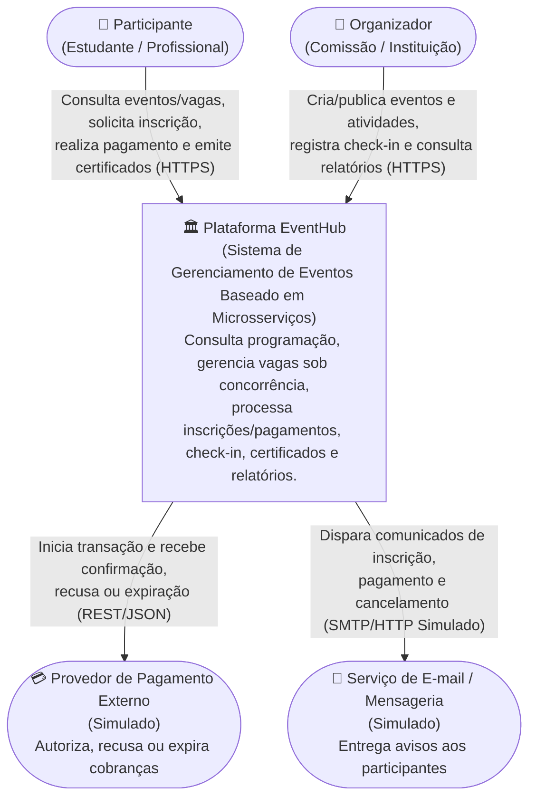
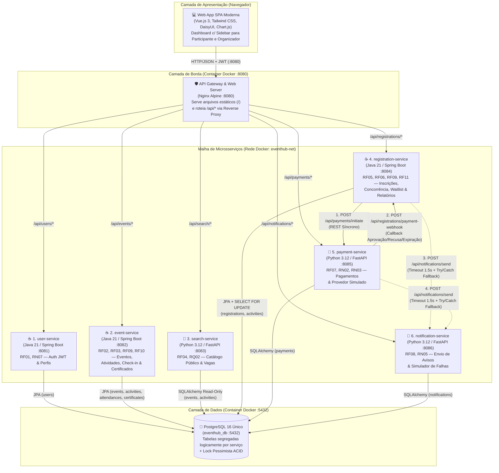
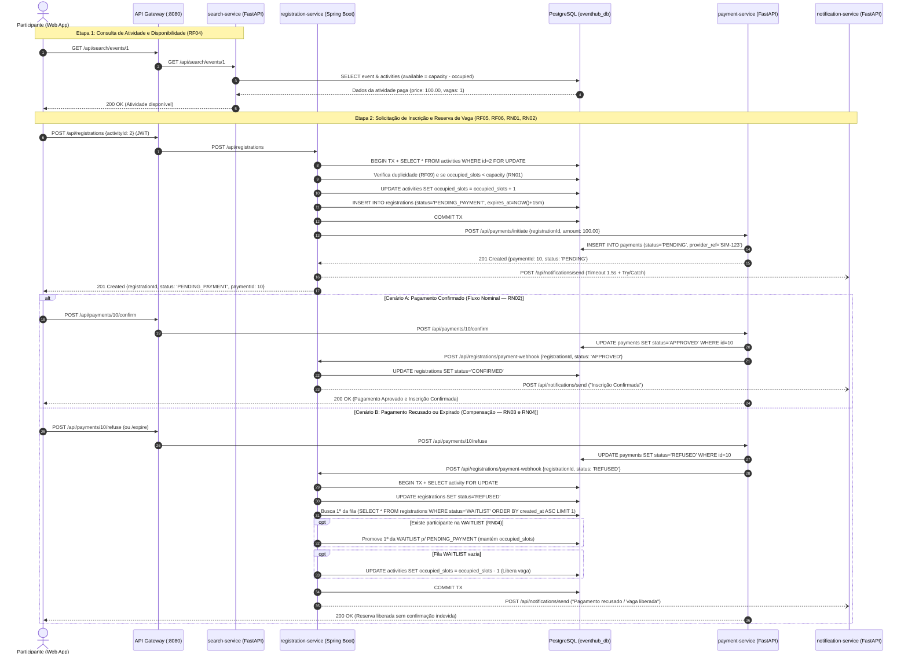

# Parte I — Architectural Design: Plataforma EventHub

Este documento apresenta o projeto arquitetural completo (**Parte I — Item 6** de [Trabalho_2_EventHub_Microsservicos.docx](Trabalho_2_EventHub_Microsservicos.docx)), alinhado com a decomposição de serviços de [Microsservicos.txt](Microsservicos.txt) e com o roteiro técnico definido em [PLANO_PROJETO_EVENTHUB.md](PLANO_PROJETO_EVENTHUB.md).

---

## 1. Análise de Domínio, Capacidades de Negócio, Limites de Contexto e Granularidade

> **Pergunta orientadora**: *Which business capabilities should become independently deployable services, and why?*

Em vez de criar mecanicamente um microsserviço para cada um dos 11 Requisitos Funcionais (RF01 a RF11) — o que geraria um "monólito distribuído" altamente acoplado e com excesso de chamadas de rede (*chatty I/O*) —, o domínio do **EventHub** foi analisado segundo **Domain-Driven Design (DDD)**, **coesão funcional**, **taxa de mudança (*rate of change*)** e **perfil de escalabilidade (RQ01, RQ02, RQ03)**. O resultado são **6 microsserviços candidatos de domínio**, apoiados por um **API Gateway + Aplicação Web**.

### 1.1. Mapeamento de Capacidades, Limites de Contexto (*Bounded Contexts*) e Responsabilidades

| # | Microsserviço | Contexto Delimitado (DDD) | Stack Tecnológica | Capacidades de Negócio Agrupadas (RFs e RNs) | Justificativa de Granularidade e Coesão |
|---|---|---|---|---|---|
| **1** | **`user-service`** *(Serviço de Usuários/Perfis)* | Identidade e Acesso (*IAM Context*) | Java 21 / Spring Boot 3 | **RF01, RN07, RQ07**: Cadastro de usuários, autenticação com emissão de JWT, manutenção de perfis e diferenciação de papéis (`PARTICIPANT` e `ORGANIZER`). | Contexto transversal de segurança. Isola credenciais e regras de autenticação do restante do domínio, evoluindo independentemente das regras de eventos. |
| **2** | **`event-service`** *(Serviço de Eventos e Programações)* | Gestão Acadêmica e Operação do Evento (*Event & Attendance Context*) | Java 21 / Spring Boot 3 | **RF02, RF03, RF09 (Check-in), RF10, RN06, RN07**: Ciclo de vida de eventos (criar, editar, publicar, cancelar), cadastro de atividades (horários, locais, vagas, preço, lista de espera), registro de presença (*check-in*) e emissão de certificados pós-conclusão. | Agrupa RF02, RF03, RF09 (presença) e RF10 porque **atividades, presença e certificados compartilham o mesmo ciclo de vida operacional do evento** (RN06 exige que a atividade esteja concluída e o check-in registrado para emitir certificado). Separar check-in e certificados em microsserviços distintos adicionaria chamadas remotas desnecessárias para validar regras fortemente coesas. |
| **3** | **`search-service`** *(Serviço de Busca)* | Catálogo Público e Descoberta (*Discovery / Query Context*) | Python 3.12 / FastAPI | **RF04, RQ02**: Consulta otimizada de eventos publicados, programação detalhada, preços e saldo de vagas em tempo real. | Separado do `event-service` por **força arquitetural de escalabilidade seletiva (RQ02)**: durante a abertura de inscrições, consultas recebem até 20× a carga normal. Um serviço leve *read-only* em FastAPI escala horizontalmente sem impactar a escrita administrativa de eventos. |
| **4** | **`registration-service`** *(Serviço de Inscrição)* | Gestão de Vagas, Filas e Inteligência Operacional (*Enrollment Context*) | Java 21 / Spring Boot 3 | **RF05, RF06, RF09 (Duplicidade), RF11, RN01, RN02, RN03, RN04, RN05**: Solicitação, consulta e cancelamento de inscrições; controle estrito de vagas sob concorrência; lista de espera automática; prevenção de inscrições duplicadas; relatórios e indicadores de ocupação/pagamento/comparecimento. | É o coração transacional do sistema. Agrupa RF05, RF06 e a prevenção de duplicidade (RF09) porque a reserva de vaga e a fila de espera exigem atomicidade (RN01). Inclui RF11 (Relatórios) pois detém os estados de inscrição, vagas e pagamentos consolidados. |
| **5** | **`payment-service`** *(Serviço de Pagamento)* | Faturamento e Gateway Financeiro (*Billing Context*) | Python 3.12 / FastAPI | **RF07, RN02, RN03**: Inicialização de cobrança junto a provedor externo simulado e processamento de confirmação (`APPROVED`), recusa (`REFUSED`) ou expiração (`EXPIRED`). | Isola a integração com provedores externos e o ciclo de vida financeiro. Permite alterar gateways de pagamento ou regras de cobrança sem modificar o motor de alocação de vagas. |
| **6** | **`notification-service`** *(Serviço de Notificação)* | Comunicação com o Usuário (*Notification Context*) | Python 3.12 / FastAPI | **RF08, RN05, RQ01, RQ03**: Envio e registro de comunicações (inscrição, confirmação, lista de espera, cancelamento, pagamento). | Isolado por **requisito de evolução independente (RQ01)** e **isolamento de falhas (RN05/RQ03)**: mudanças em templates/canais de e-mail ocorrem com frequência e sua indisponibilidade jamais pode bloquear o fluxo principal de inscrições. |

### 1.2. Critérios Utilizados para Definir a Granularidade
1. **Agrupamento por Afinidade Transacional e Regra de Negócio**: RF05 + RF06 foram unidos no `registration-service` porque verificar capacidade, bloquear *overbooking* (RN01) e alocar em lista de espera (RN04) precisam ocorrer na mesma fronteira transacional. Analogamente, RF02 + RF03 + RF09 (check-in) + RF10 foram unidos no `event-service` pela dependência direta da regra RN06.
2. **Separação por Perfil de Carga Assimétrico (RQ02)**: O `search-service` (leitura intensiva) e o `registration-service` (escrita concorrente intensa na abertura de vagas) foram separados do `event-service` (carga baixa/administrativa e emissão de certificados pós-evento).
3. **Separação por Tolerância a Falhas e Dependência Externa (RQ03 / RN05)**: `payment-service` e `notification-service` lidam com sistemas externos (gateways financeiros e servidores de mensageria/e-mail) e precisam de fronteiras isoladas para não degradar o núcleo do sistema.

---

## 2. Diagramas de Arquitetura (C4 Model)

### 2.1. Diagrama de Contexto do Sistema (C4 — Nível 1)

O diagrama de contexto apresenta o **EventHub** como uma caixa-preta, destacando seus atores humanos (**Participante** e **Organizador**) e as integrações externas (**Provedor de Pagamento Simulado** e **Servidor de E-mail/Mensageria Simulado**).



### 2.2. Diagrama de Containers e Serviços (C4 — Nível 2)

O diagrama de containers detalha a topologia de execução em containers Docker, evidenciando as tecnologias (Java/Spring Boot, Python/FastAPI, Nginx e PostgreSQL único), as portas expostas, as interfaces REST e os fluxos síncronos/resilientes.



---

## 3. Propriedade dos Dados, Políticas de Acesso e Compartilhamento em Banco Único

Por requisito de infraestrutura do projeto, todos os 6 microsserviços utilizam **uma instância única do banco de dados PostgreSQL (`eventhub_db`)**. Entretanto, para preservar os princípios de baixo acoplamento e autonomia de microsserviços, aplica-se a política de **Propriedade Lógica Estrita de Escrita (*Single Writer Principle*)** combinada com **Projeções de Leitura Local (*Shared Read Projection*)** apenas onde estritamente justificado.

### 3.1. Matriz de Propriedade e Políticas de Acesso às Tabelas

| Tabela no `eventhub_db` | Microsserviço Proprietário (Escrita / DDL) | Serviços com Permissão de Leitura | Política de Acesso e Justificativa Arquitetural |
|---|---|---|---|
| `users` | **`user-service`** (Exclusivo) | `user-service` (Leitura em relatórios/listagens via join ou claim JWT) | Nenhum outro serviço altera usuários. Identidade (`userId`, `email`, `role`) trafega assinada dentro do Token JWT para evitar chamadas síncronas ao `user-service` a cada requisição. |
| `events` | **`event-service`** (Exclusivo) | `event-service`, `search-service`, `registration-service` | Apenas `event-service` cria, edita, publica ou cancela eventos. O `search-service` realiza leitura (*CQRS Read Model simplificado*) para responder consultas de alta performance (RF04/RQ02). |
| `activities` | **`event-service`** (Cadastro/Regras) e **`registration-service`** (Contador `occupied_slots`) | `event-service`, `search-service`, `registration-service` | **Justificativa Excepcional de Compartilhamento**: Para cumprir **RN01** e **RQ04** (zero *overbooking* sob alta concorrência) com a menor complexidade possível e sem coordenadores distribuídos (Redis/Zookeeper), o `registration-service` executa `SELECT ... FOR UPDATE` na linha de `activities` e atualiza atomicamente `occupied_slots` na mesma transação local em que insere o registro em `registrations`. |
| `registrations` | **`registration-service`** (Exclusivo) | `registration-service`, `event-service` (validação de check-in) | Apenas `registration-service` cria ou altera estados de inscrição (`CONFIRMED`, `PENDING_PAYMENT`, `WAITLIST`, `CANCELLED`, `REFUSED`, `EXPIRED`). O `event-service` consulta se a inscrição está `CONFIRMED` no momento do check-in (RF09). |
| `attendances` | **`event-service`** (Exclusivo) | `event-service`, `registration-service` (indicador RF11) | Apenas `event-service` registra presenças (check-in). O `registration-service` contabiliza o total de presenças (`COUNT`) para compor o relatório do organizador (RF11). |
| `certificates` | **`event-service`** (Exclusivo) | `event-service` | Isolamento total no `event-service`. Nenhum outro serviço acessa esta tabela. |
| `payments` | **`payment-service`** (Exclusivo) | `payment-service`, `registration-service` (indicador financeiro RF11) | Apenas `payment-service` cria e transiciona cobranças (`PENDING`, `APPROVED`, `REFUSED`, `EXPIRED`). A sincronização de estado com `registration-service` ocorre **via contrato de API REST** (`/api/registrations/payment-webhook`), e nunca por escrita cruzada no banco. |
| `notifications` | **`notification-service`** (Exclusivo) | `notification-service` | Isolamento total no `notification-service`. Toda comunicação entre `registration-service`/`payment-service` e `notification-service` ocorre exclusivamente via API HTTP (`POST /api/notifications/send`). |

---

## 4. Mecanismos de Comunicação, Contratos, Tratamento de Erros e Idempotência

### 4.1. Escolha entre Comunicação Síncrona e Assíncrona
Para atender à diretriz de **menor complexidade possível de implementação**, adotou-se **Comunicação HTTP/REST Síncrona com JSON** em toda a malha de serviços, combinada com **Degradação Graciosa (*Timeout Curto + Try/Catch Fallback*)** nas chamadas destinadas ao `notification-service`.
- **Por que chamadas síncronas entre `registration-service` e `payment-service`?** Quando o participante solicita inscrição em atividade paga, ele precisa receber imediatamente na resposta HTTP os dados da cobrança gerada (`paymentId`, `amount`, `status: PENDING`) para realizar o pagamento na interface Web.
- **Por que degradação graciosa em vez de mensageria assíncrona para o `notification-service`?** Um *Message Broker* (RabbitMQ/Kafka) exigiria containers extras, gerenciamento de filas e consumidores em background. Com um cliente HTTP configurado com *timeout* máximo de `1.5s` dentro de um bloco `try/catch` que engole falhas do `notification-service` e registra log `WARN`, atinge-se o exato mesmo efeito funcional exigido em **RN05** e **RQ03** (falhas na notificação nunca revertem nem bloqueiam a inscrição) com zero infraestrutura adicional.

### 4.2. Principais Contratos Explícitos entre Microsserviços (RQ05)

1. **Criação de Cobrança (`registration-service` Java → `payment-service` Python)**:
   - **Endpoint**: `POST http://payment-service:8085/api/payments/initiate`
   - **Request Payload**:
     ```json
     {
       "registrationId": 104,
       "userId": 3,
       "userEmail": "ana@email.com",
       "amount": 150.00
     }
     ```
   - **Response (`201 Created`)**:
     ```json
     {
       "paymentId": 52,
       "registrationId": 104,
       "status": "PENDING",
       "providerRef": "SIM-PAY-9F8A7B",
       "amount": 150.00
     }
     ```

2. **Webhook de Atualização de Pagamento (`payment-service` Python → `registration-service` Java)**:
   - **Endpoint**: `POST http://registration-service:8084/api/registrations/payment-webhook`
   - **Request Payload**:
     ```json
     {
       "paymentId": 52,
       "registrationId": 104,
       "status": "APPROVED"
     }
     ```
   - *(Valores aceitos para `status`: `"APPROVED"`, `"REFUSED"`, `"EXPIRED"`)*

3. **Disparo de Notificação (`registration-service` / `payment-service` → `notification-service` Python)**:
   - **Endpoint**: `POST http://notification-service:8086/api/notifications/send`
   - **Request Payload**:
     ```json
     {
       "userId": 3,
       "recipientEmail": "ana@email.com",
       "eventType": "REGISTRATION_CONFIRMED",
       "message": "Sua inscrição #104 na atividade 'Workshop de Microsserviços' foi confirmada."
     }
     ```

### 4.3. Tratamento de Erros e Garantias de Idempotência

- **Padronização de Erros HTTP**:
  - `400 Bad Request` / `422 Unprocessable Entity`: Violação de regra de negócio (ex.: tentar emitir certificado sem presença registrada ou antes do término da atividade — RN06).
  - `401 Unauthorized` / `403 Forbidden`: Token JWT ausente/inválido ou tentativa de acesso a dados de outro usuário/organizador (RN07).
  - `409 Conflict`: Tentativa de inscrição duplicada (RF09), check-in duplicado (RF09) ou atividade lotada sem lista de espera habilitada (RF06).
  - `503 Service Unavailable`: Retornado pelo `notification-service` quando em modo de falha simulada (tratado graciosamente pelos clientes).
- **Idempotência nas Operações Críticas**:
  1. **Solicitação de Inscrição (`POST /api/registrations`)**: Caso o participante envie duas requisições seguidas para a mesma atividade, o `registration-service` verifica a existência de inscrição ativa (`CONFIRMED`, `PENDING_PAYMENT`, `WAITLIST`) para o par `(user_id, activity_id)` sob transação, impedindo duplicação (RF09).
  2. **Webhook de Pagamento (`POST /api/registrations/payment-webhook`)**: É estritamente **idempotente**. Se o webhook receber `"APPROVED"` para uma inscrição que já está `"CONFIRMED"`, ou receber `"REFUSED"`/`"EXPIRED"` para uma inscrição que já teve sua vaga liberada, o método retorna `200 OK` sem alterar novamente o contador `occupied_slots`.
  3. **Check-in de Presença (`POST /api/events/attendance/check-in`)**: Protegido pela constraint `UNIQUE(registration_id)` na tabela `attendances`, garantindo que múltiplos cliques do organizador jamais gerem duas presenças para o mesmo inscrito (RF09).
  4. **Emissão de Certificados (`POST /api/events/certificates/issue`)**: Operação idempotente — se o certificado já foi emitido anteriormente para o par `(user_id, activity_id)`, o serviço retorna o certificado existente com o mesmo `validation_code` sem duplicar registros.

---

## 5. Avaliação de Padrões Arquiteturais e Seleção Enxuta

A tabela a seguir sintetiza a avaliação dos padrões arquiteturais candidatos frente aos requisitos do EventHub e justifica quais foram **adotados** e quais foram **descartados** em prol da simplicidade:

| Padrão Arquitetural | Avaliação Técnica no Cenário EventHub | Decisão | Justificativa Baseada em Forças e Trade-offs |
|---|---|---|---|
| **API Gateway** | Unifica o ponto de entrada (`:8080`) para os 6 microsserviços e hospeda a Web App SPA, centralizando roteamento e cabeçalhos de rastreamento. | **ADOTADO** *(Nginx Reverse Proxy)* | Simplifica drasticamente o frontend Web (sem CORS e sem conhecer múltiplas portas) com custo de configuração mínimo (`nginx.conf`). |
| **Circuit Breaker Formal e Retry** | Protege o tráfego Leste–Oeste síncrono contra falhas em cascata e lentidão em dependências críticas (`payment-service`, webhook e fallback de notificações). | **ADOTADO** *(Resilience4j no Java + PyBreaker e Tenacity no Python)* | Implementa máquinas de estado formais (`CLOSED`, `OPEN`, `HALF_OPEN`) com *fail-fast* (< 1ms) e retries exponenciais, isolando indisponibilidades transitórias (RN05, RQ03, ADR-05). |
| **Publish / Subscribe com Message Broker & DLQ** | Desacoplamento temporal e assíncrono para notificações e eventos de domínio via RabbitMQ, com Dead Letter Queue (`DLQ`) para retenção de mensagens rejeitadas. | **ADOTADO** *(RabbitMQ 3.13 TopicExchange + DLQ + worker aio-pika)* | Garante *zero message loss* em caso de indisponibilidade de notificações (`RN05`, `RQ01`, `RQ03`), mantendo padrão *Dual-Mode* (broker-first com fallback HTTP) e desacoplando locks de banco com `AFTER_COMMIT` (ADR-05). |
| **Saga (Orquestração vs. Coreografia)** | Coordena a reserva de vaga no `registration-service` e o pagamento no `payment-service` (RN02, RN03). | **ADOTADO (Simplificado)** *(Saga Síncrona via REST Callback + Compensação)* | O `registration-service` reserva a vaga (`PENDING_PAYMENT`) e o `payment-service` executa o callback confirmando (`CONFIRMED`) ou disparando a **transação compensatória** de liberação da vaga (`REFUSED`/`EXPIRED`). Evita máquinas de estado baseadas em eventos para o fluxo financeiro principal. |
| **Database per Service vs. Shared Database** | Isolamento físico vs. banco PostgreSQL único compartilhado. | **ADOTADO: Banco PostgreSQL Único c/ Propriedade Lógica** | Atende à restrição do projeto de usar um único PostgreSQL, reduzindo drasticamente o consumo de RAM no Docker Compose (RQ08) e permitindo lock pessimista ACID na disputa de vagas (RN01, ADR-02). |
| **Transactional Outbox** | Garante publicação atômica de eventos em um Message Broker junto com o commit no banco. | **SUBSTITUÍDO POR `AFTER_COMMIT` NATIVO + DUAL-MODE** | A publicação de eventos AMQP é registrada via `TransactionSynchronizationManager.registerSynchronization(afterCommit)` nos serviços Spring Boot, liberando o lock de banco antes de qualquer I/O externo e contando com fallback HTTP protegido por Circuit Breaker caso o broker esteja indisponível, eliminando a complexidade de tabelas outbox e polling. |

---

## 6. Fluxo Completo de Inscrição Paga e Comportamento em Cenários de Falha

Abaixo estão descritos o fluxo nominal de uma inscrição em atividade paga (**RN01, RN02**) e o comportamento exato da arquitetura nos três cenários críticos de exceção (**RN03, RN04, RN05, RQ03**).



### 6.1. Comportamento Detalhado nos Casos de Exceção e Falha

1. **Caso 1 — Pagamento Recusado pelo Provedor Simulado (`RN03`)**:
   - O participante ou simulador aciona `POST /api/payments/{id}/refuse`.
   - O `payment-service` grava `status = REFUSED` na tabela `payments` e invoca o webhook `POST /api/registrations/payment-webhook` com `status = "REFUSED"`.
   - O `registration-service` executa a **transação compensatória**: marca a inscrição como `REFUSED` (impedindo qualquer confirmação indevida) e verifica se há candidatos em `WAITLIST` para aquela atividade:
     - Se houver alguém na `WAITLIST` (**RN04**), promove automaticamente o primeiro inscrito da fila para `PENDING_PAYMENT` e gera nova cobrança para ele.
     - Se não houver ninguém na `WAITLIST`, decrementa `occupied_slots` em `1`, devolvendo imediatamente a vaga ao estoque público consultado pelo `search-service`.

2. **Caso 2 — Timeout / Expiração do Prazo da Reserva Pendente (`RN02` e `RN03`)**:
   - Toda inscrição em atividade paga nasce com `status = PENDING_PAYMENT` e um carimbo `expires_at` configurável (ex.: `created_at + 15 minutos`).
   - Quando o tempo limite se esgota sem pagamento (acionado via endpoint de expiração no simulador `POST /api/payments/{id}/expire` ou pela rotina de limpeza de reservas vencidas `POST /api/registrations/expire-overdue` no `registration-service`):
     - O pagamento passa para `EXPIRED` e a inscrição passa para `EXPIRED`.
     - A vaga reservada é imediatamente liberada (`occupied_slots - 1`) ou repassada ao próximo participante da `WAITLIST` (**RN04**).

3. **Caso 3 — Indisponibilidade de Dependências (`notification-service` ou `payment-service` fora do ar)**:
   - **Indisponibilidade do `notification-service` (`RN05`, `RQ03`)**:
     - *Modo Assíncrono com RabbitMQ (Nominal)*: O `registration-service`, `event-service` e `payment-service` publicam eventos na Topic Exchange `eventhub.domain.events` após a efetivação transacional (`AFTER_COMMIT`). O consumidor `aio-pika` no `notification-service` consome a fila `eventhub.notifications.queue`. Quando a simulação de falha (`simulateFailure=true` / `503`) está ativa, o consumidor rejeita a mensagem (`requeue=False`), fazendo com que o broker a encaminhe automaticamente via Dead Letter Exchange (`eventhub.domain.dlx`) para a **`eventhub.notifications.dlq`**, assegurando **zero perda de dados** sem interromper ou atrasar o fluxo de inscrições e pagamentos.
     - *Modo Fallback HTTP Dual-Mode*: Caso o broker RabbitMQ esteja indisponível, os produtores executam fallback automático para a chamada REST `POST /api/notifications/send`, que é protegida por Circuit Breaker (**Resilience4j** `notificationServiceCB` no Java e **PyBreaker** `notification_cb` no Python). Se o serviço de notificações estiver offline ou lento (timeout 1.5s), o circuito abre em modo *fail-fast* (< 1ms), permitindo que a inscrição permaneça `CONFIRMED` e o pagamento `APPROVED` sem travar a aplicação.
   - **Indisponibilidade do `payment-service` durante inscrição paga (`RQ04`)**:
     - Se o `payment-service` estiver inacessível no exato momento em que o participante tenta se inscrever em uma atividade **paga**, o `registration-service` (protegido por `@CircuitBreaker(name = "paymentServiceCB")`) captura a falha e reverte a reserva (liberando a vaga imediatamente), retornando `503 Service Unavailable` ao usuário para que nenhuma vaga fique presa eternamente em `PENDING_PAYMENT` sem uma cobrança associada. Enquanto isso, inscrições em **atividades gratuitas** continuam funcionando normalmente (`100% disponíveis`), pois não dependem do `payment-service`.

---

## 7. Architectural Decision Records (ADRs)

A seguir estão registradas as **5 ADRs** fundamentais do projeto, documentando contexto, alternativas consideradas, decisão tomada, evidências técnicas, justificativa e consequências (trade-offs).

---

### ADR-01: Adoção de API Gateway (Nginx) e Orquestração REST Síncrona Inicial com Degradação Graciosa

- **Status**: Aceita (Evoluída e complementada pela ADR-05 para comunicação híbrida Leste–Oeste com Publish/Subscribe e Circuit Breaker)
- **Contexto**:
  - O sistema possui 6 microsserviços implementados em duas stacks (Java/Spring Boot e Python/FastAPI) consumidos por uma Aplicação Web SPA.
  - É necessário integrar o fluxo de inscrição, pagamento e notificação garantindo que a indisponibilidade do serviço de notificações não afete operações críticas (RN05, RQ03), mantendo a menor complexidade arquitetural e operacional possível (RQ08).
- **Alternativas Consideradas**:
  1. **Arquitetura Orientada a Eventos (Publish/Subscribe com RabbitMQ ou Apache Kafka) + Transactional Outbox**: Desacoplamento assíncrono total entre inscrição, pagamento e notificação.
  2. **Service Mesh + Circuit Breaker Pesado (Envoy / Istio / Resilience4j completo)**: Malha de proxies laterais gerenciando retries e abertura de circuito.
  3. **API Gateway Unificado (Nginx) + Orquestração REST Síncrona com Timeout Curto e Try/Catch Fallback Local (Degradação Graciosa)**.
- **Decisão**:
  - Adotar a **Alternativa 3**: O Nginx atua como API Gateway na porta `8080`, o `registration-service` orquestra síncronamente o `payment-service` via REST, e as chamadas ao `notification-service` são encapsuladas com *timeout* de `1.5s` e *fallback* silencioso em log (`try/catch`).
- **Evidências e Justificativa**:
  - Em um ambiente acadêmico e reproduzível localmente via Docker Compose (RQ08), introduzir RabbitMQ/Kafka e *workers* consumidores em duas linguagens dobraria a quantidade de código de infraestrutura sem necessidade funcional, visto que o usuário precisa de feedback imediato sobre sua reserva e cobrança.
  - O *try/catch* com *timeout* de `1.5s` cumpre rigorosamente **RN05** e **RQ03**: quando o `notification-service` retorna `503` ou fica indisponível, a inscrição é confirmada com sucesso em menos de 2 segundos.
- **Consequências**:
  - *Positivas*: Menor consumo de memória RAM; ausência de *broker* para manter; rastreamento simples via logs HTTP síncronos (RQ06); eliminação de problemas de CORS na aplicação Web.
  - *Negativas / Trade-offs*: Notificações disparadas durante um período de queda do `notification-service` são apenas registradas no log de erro do serviço chamador, não sendo reenviadas automaticamente por uma fila de retentativa (*dead-letter queue*).

---

### ADR-02: Banco de Dados PostgreSQL Único Compartilhado com Segregação Lógica de Propriedade

- **Status**: Aceita
- **Contexto**:
  - Os 6 microsserviços necessitam de persistência relacional para armazenar usuários, eventos, atividades, inscrições, presenças, certificados, pagamentos e notificações.
  - A diretriz do projeto estabelece o uso de um banco de dados PostgreSQL único compartilhado em container, enquanto a arquitetura exige baixo acoplamento e definição clara de propriedade dos dados.
- **Alternativas Consideradas**:
  1. **Database per Service Físico (6 instâncias separadas de PostgreSQL no Docker Compose)**.
  2. **Banco PostgreSQL Único (`eventhub_db`) sem regras de fronteira (todos os serviços escrevendo em todas as tabelas)**.
  3. **Banco PostgreSQL Único (`eventhub_db`) com Propriedade Lógica Estrita por Tabela (*Single Writer*) e Projeção de Leitura Controlada**.
- **Decisão**:
  - Adotar a **Alternativa 3**: Um único container `eventhub-postgres` hospeda o banco `eventhub_db` inicializado por `infra/postgres/init.sql`, mas cada tabela possui um único microsserviço proprietário responsável pelo seu ciclo de vida, exceto o contador `occupied_slots` atualizado sob transação atômica na reserva de vagas.
- **Evidências e Justificativa**:
  - Rodar 6 instâncias do PostgreSQL simultaneamente junto com 3 JVMs Spring Boot e 3 processos Python Uvicorn consumiria recursos excessivos em máquinas locais (violando RQ08).
  - O compartilhamento controlado de leitura permite que o `search-service` (FastAPI) execute consultas de catálogo e vagas em milissegundos (RF04, RQ02) e que o `registration-service` consolide os indicadores do organizador (RF11) sem precisar de pipelines complexos de replicação de dados (CDC/Debezium).
- **Consequências**:
  - *Positivas*: Operabilidade local leve e rápida (`docker compose up`); consistência transacional imediata (RQ04); zero latência de sincronização entre a gravação de um evento e sua exibição na busca pública.
  - *Negativas / Trade-offs*: Acoplamento no nível de esquema de banco de dados (mudanças estruturais nas colunas de `events` ou `activities` exigem coordenação entre `event-service`, `search-service` e `registration-service`) e ponto único de falha na camada de armazenamento.

---

### ADR-03: Controle de Concorrência de Vagas com Bloqueio Pessimista (`SELECT ... FOR UPDATE`)

- **Status**: Aceita
- **Contexto**:
  - Durante a abertura de inscrições, dezenas de participantes tentam se inscrever simultaneamente na mesma atividade (RQ02).
  - A regra **RN01** e o atributo **RQ04** determinam que uma inscrição jamais pode resultar em ocupação superior à capacidade da atividade (*zero overbooking*), devendo encaminhar excedentes para a lista de espera quando habilitada (RF06).
- **Alternativas Consideradas**:
  1. **Verificação em Memória na Aplicação (`if occupied < capacity`) sem Lock no Banco**: Sujeito a condição de corrida clássica (*Check-Then-Act Race Condition*).
  2. **Bloqueio Otimista (`@Version` no JPA)**: Rejeita com exceção todas as transações concorrentes que perderem a corrida, forçando o usuário a tentar novamente mesmo quando ainda restam vagas.
  3. **Lock Distribuído Externo (Redis / Redlock)**: Exige container adicional de Redis e gestão de *leases*.
  4. **Bloqueio Pessimista no Banco de Dados (`@Lock(LockModeType.PESSIMISTIC_WRITE)` / `SELECT ... FOR UPDATE`) + Constraint `CHECK (occupied_slots <= capacity)`**.
- **Decisão**:
  - Adotar a **Alternativa 4** no `registration-service` ao consultar a linha da atividade para reservar ou liberar vaga.
- **Evidências e Justificativa**:
  - O comando `SELECT ... FOR UPDATE` do PostgreSQL serializa no nível de linha (*row-level lock*) apenas as transações que disputam a **mesma atividade** naquele milissegundo.
  - Diferentemente do lock otimista, as requisições concorrentes não falham prematuramente: elas aguardam alguns milissegundos na fila do lock transacional, preenchem as vagas disponíveis uma a uma com precisão matemática e, assim que `occupied_slots == capacity`, as requisições subsequentes entram limpa e automaticamente na `WAITLIST` (RF06).
- **Consequências**:
  - *Positivas*: Garantia matemática de zero *overbooking* validável por teste de estresse concorrente (`scripts/test_concurrency.py`); experiência fluida para o usuário (sem erros espúrios quando ainda há vagas ou lista de espera); zero infraestrutura adicional.
  - *Negativas / Trade-offs*: Contenção momentânea de threads no banco para uma mesma atividade extremamente disputada durante a janela de milissegundos da transação de reserva.

---

### ADR-04: Arquitetura Poliglota com Java 21 (Spring Boot 3) e Python 3.12 (FastAPI)

- **Status**: Aceita
- **Contexto**:
  - O projeto exige o uso de pelo menos duas tecnologias distintas entre os microsserviços (Parte II — Item 7) e interoperabilidade via contratos explícitos (RQ05).
- **Alternativas Consideradas**:
  1. **Divisão Arbitrária sem Critério Técnico**.
  2. **Alocação Estratégica por Perfil de Carga e Responsabilidade**: Java 21 / Spring Boot 3 para serviços transacionais e de regras de domínio densas (`user-service`, `event-service`, `registration-service`) e Python 3.12 / FastAPI para serviços de I/O leve, leitura rápida e integração externa (`search-service`, `payment-service`, `notification-service`).
- **Decisão**:
  - Adotar a **Alternativa 2**, dividindo exatamente 3 microsserviços em Java/Spring Boot e 3 microsserviços em Python/FastAPI, mantendo estrutura interna padronizada por tipo de classe (`controller`, `service`, `repository`, `model`, `dto`/`schema`, `config`).
- **Evidências e Justificativa**:
  - **Spring Boot + Spring Data JPA + Spring Security** oferecem suporte maduro e declarativo para transações ACID complexas, bloqueio pessimista (`@Lock(PESSIMISTIC_WRITE)`) no `registration-service` e filtros de segurança JWT no `user-service` e `event-service`.
  - **Python + FastAPI + Uvicorn** possuem inicialização instantânea, baixíssimo *footprint* de memória e alta vazão para consultas JSON no `search-service` (RQ02), além de extrema agilidade para simular webhooks financeiros (`payment-service`) e *chaos switches* de falha (`notification-service`).
- **Consequências**:
  - *Positivas*: Aproveita os pontos fortes de cada ecossistema; comprova na prática a interoperabilidade tecnológica via REST/JSON (RQ05) em fluxos que cruzam Java → Python → Java.
  - *Negativas / Trade-offs*: A equipe precisa manter dois conjuntos de imagens base Docker (`maven/eclipse-temurin:21` e `python:3.12-slim`) e duas bibliotecas de mapeamento objeto-relacional (Hibernate/JPA e SQLAlchemy).

---

### ADR-05: Adoção de Arquitetura de Comunicação Híbrida Leste–Oeste: Publish/Subscribe Assíncrono (RabbitMQ + Dead Letter Queue) e Circuit Breaker Formal (Resilience4j + PyBreaker/Tenacity)

- **Status**: Aceita (Evolução direta da ADR-01 para comunicação entre microsserviços)
- **Contexto**:
  - Na fase inicial do projeto (ADR-01), optou-se por orquestração síncrona REST com degradação graciosa em bloco `try/catch` para notificações (RN05, RQ03), visando rápida reprodutibilidade em Docker Compose com menor quantidade inicial de componentes de infraestrutura.
  - Conforme o protótipo evoluiu e foi submetido a testes de estresse concorrente e injeção de falhas (Parte III — Item 8 do enunciado da Wave 4), emergiram duas limitações críticas do modelo puramente síncrono:
    1. **Risco de perda de mensagens durante indisponibilidades prolongadas (RN05, RQ01, RQ03)**: Quando o `notification-service` ficava temporariamente fora do ar ou em modo de falha simulada (503), os comunicados eram capturados em `try/catch` e gravados apenas no log local de erro (`WARN`) dos serviços chamadores, sem reprocessamento posterior garantido (*zero delivery guarantee*).
    2. **Contenção transacional no banco e risco de falhas em cascata (RN01, RQ04)**: No fluxo crítico de inscrição, o participante obtém um bloqueio pessimista (`SELECT ... FOR UPDATE`) sobre a atividade no PostgreSQL. Executar I/O remoto síncrono mantendo o lock aberto ou aguardando timeouts cumulativos de serviços dependentes (`notification-service`, `payment-service`) degrada severamente a vazão de concorrência e pode esgotar o pool de conexões e threads do Tomcat e Uvicorn (*cascading failure*), sem uma máquina de estados formal (*fail-fast*) que rejeite chamadas degradadas em $<1\text{ms}$.
  - Faz-se necessário adotar mecanismos formais de resiliência e desacoplamento assíncrono que garantam **entrega confiável sem bloqueio** e **proteção de circuito**, mantendo a execução fluida em ambiente local.
- **Alternativas Consideradas**:
  1. **Manter REST Síncrono com Loop de Retentativas em Memória (Retry Simples)**:
     - *Avaliação*: Retentativas síncronas contra um serviço lento ou fora do ar sobrecarregam ainda mais as threads do chamador, aumentam a contenção no banco e disparam tempestades de requisições (*retry storms*), sem garantir que eventos gerados durante quedas de minutos sejam recuperados.
  2. **Migração Global para Apache Kafka + Event Sourcing + Transactional Outbox**:
     - *Avaliação*: Kafka com conectores Outbox/Debezium adiciona severa complexidade operacional e consumo de memória excessivo (violando a restrição de execução leve do RQ08), além de desnecessariamente alterar a semântica síncrona esperada na consulta de vagas e reserva imediata.
  3. **Padrão Híbrido: Publish/Subscribe Assíncrono com RabbitMQ (TopicExchange + DLQ) + Orquestração Síncrona Protegida por Circuit Breakers Formais (Resilience4j e PyBreaker/Tenacity) e Padrão Dual-Mode (Broker-First com Fallback HTTP)**:
     - *Avaliação*: Utilizar um message broker leve (**RabbitMQ 3.13**) para trafegar eventos de domínio (`eventhub.domain.events`), com uma **Dead Letter Queue (`eventhub.notifications.dlq`)** para reter sem perda as mensagens rejeitadas durante falhas do consumidor.
     - Isolar o lock pessimista transacional disparando a publicação de eventos apenas na fase `AFTER_COMMIT` (`TransactionSynchronizationManager`) nos serviços Java.
     - Proteger as integrações síncronas restantes (`registration-service` $\leftrightarrow$ `payment-service`) com Circuit Breakers formais (Resilience4j no Spring Boot e PyBreaker no FastAPI) e retries exponenciais curtos.
     - Adotar a estratégia *Dual-Mode*: caso o RabbitMQ esteja inacessível ou desabilitado, os produtores realizam fallback transparente e automático para chamadas REST protegidas pelo Circuit Breaker.
- **Decisão**:
  - Adotar a **Alternativa 3**, implementando a arquitetura híbrida de mensageria assíncrona com DLQ e Circuit Breaker formal entre os microsserviços.
  - **Especificação Técnica da Implementação**:
    - **Infraestrutura AMQP (`docker-compose.yml`)**:
      - Container `eventhub-rabbitmq` (`rabbitmq:3.13-management-alpine`) na porta `5672` (AMQP) e `15672` (Management UI).
      - Topic Exchange durável `eventhub.domain.events`.
      - Dead Letter Exchange (DLX) `eventhub.domain.dlx` (tipo `direct`).
      - Fila durável `eventhub.notifications.queue` configurada com argumentos de dead-letter: `x-dead-letter-exchange = "eventhub.domain.dlx"` e `x-dead-letter-routing-key = "notification.dlq"`.
      - Fila durável de retenção `eventhub.notifications.dlq` vinculada à DLX com routing key `notification.dlq`.
      - Routing keys dos produtores: `notification.registration.*` (`registration-service`), `notification.event.*` (`event-service`) e `notification.payment.*` (`payment-service`).
    - **Desacoplamento do Lock Transacional (`AFTER_COMMIT`)**:
      - Nos serviços Spring Boot, a publicação AMQP é encapsulada em `TransactionSynchronizationManager.registerSynchronization(new TransactionSynchronization() { void afterCommit() { ... } })`. O lock pessimista `SELECT ... FOR UPDATE` no PostgreSQL é comitado e liberado antes de qualquer transmissão na rede.
    - **Consumo Assíncrono e Rejeição para DLQ no `notification-service`**:
      - Worker assíncrono em background utilizando `aio-pika` instanciado no ciclo de vida `lifespan` do FastAPI.
      - Quando o switch de falha simulada (`RN05`) está ativo (`simulate_failure = true`), o consumidor rejeita explicitamente a mensagem com `message.nack(requeue=False)`. O RabbitMQ encaminha o evento para a `eventhub.notifications.dlq`, preservando 100% dos dados para auditoria ou reprocessamento posterior.
    - **Circuit Breakers Formais e Retries**:
      - **Java 21 / Spring Boot 3 (Resilience4j 2.2.0)**:
        - `paymentServiceCB`: protege a iniciação e cancelamento de pagamentos em `ExternalIntegrationService`, abrindo com taxa de falha de 50%, sliding window de 10 requisições e 5 segundos de espera no estado `OPEN`.
        - `paymentServiceRetry`: 2 tentativas com backoff exponencial antes de propagar erro.
        - `registrationServiceCB`: protege o cancelamento em lote de inscrições em `RegistrationIntegrationClient`, acionando fallback SQL local imediato quando o circuito estiver aberto.
        - `notificationServiceCB`: protege o fallback HTTP de notificações em `NotificationHttpFallbackClient`, respondendo em $<1\text{ms}$ (*fail-fast*) quando o circuito está aberto.
      - **Python 3.12 / FastAPI (PyBreaker 1.2.0 + Tenacity 9.0.0)**:
        - `registration_webhook_cb`: `CircuitBreaker(fail_max=3, reset_timeout=10)` no `DownstreamClient` do `payment-service`, evitando travamento de conexões na sincronização com o `registration-service`.
        - `Tenacity`: `@retry(stop=stop_after_attempt(2), wait=wait_exponential(multiplier=0.2, min=0.2, max=1.0))` para absorver transientes rápidos de rede.
- **Evidências e Justificativa**:
  - **Zero Perda de Mensagens com Simulação de Indisponibilidade (RN05, RQ03)**: Nos testes com falha ativada (`POST /api/notifications/simulate-failure?fail=true`), o fluxo principal de inscrições e pagamentos continua sendo concluído com sucesso e latência normal (< 200ms). Ao consultar a fila de dead-letter no RabbitMQ (`http://localhost:15672`), constata-se a chegada de 100% dos eventos rejeitados na fila `eventhub.notifications.dlq`, comprovando o isolamento do serviço de notificações sem descarte de avisos.
  - **Minimização do Tempo de Lock em Alta Concorrência (RN01, RQ02, RQ04)**: O envio de eventos AMQP exclusivamente em `AFTER_COMMIT` impede que a latência de mensageria impacte a transação do banco. A disputa de vagas permanece serializada pelo tempo estrito do `UPDATE` de slots (< 5ms), viabilizando vazão de dezenas de inscrições simultâneas sem deadlocks.
  - **Proteção contra Falhas em Cascata (Fail-Fast)**: Em caso de lentidão induzida ou queda do `payment-service`, a transição de estado dos Circuit Breakers para `OPEN` rejeita requisições subsequentes em menos de 1ms, preservando a estabilidade dos pools de threads e workers dos serviços centrais.
  - **Operabilidade e Alta Disponibilidade Dual-Mode**: Se o container do RabbitMQ for temporariamente paralisado, todos os serviços produtores chaveiam automaticamente para a chamada HTTP direta protegida por Circuit Breaker, assegurando que o sistema continue operando mesmo sob falha do próprio broker.
- **Consequências**:
  - *Positivas*:
    - Desacoplamento temporal completo e garantia de não bloqueio das operações essenciais (RN05, RQ01, RQ03).
    - Tolerância a falhas robusta com armazenamento durável em DLQ para reprocessamento futuro.
    - Prevenção formal de falhas em cascata com tempos de resposta submilisegundo em modo degradado (*fail-fast*).
    - Zero impacto na integridade e velocidade do bloqueio pessimista ACID de vagas (RN01).
    - Interoperabilidade poliglota comprovada na prática: produtores em Spring Boot (Java) e FastAPI (Python) comunicando-se com consumidor em FastAPI via AMQP padrão.
  - *Negativas / Trade-offs*:
    - Adição de um container adicional de infraestrutura (`eventhub-rabbitmq`), consumindo cerca de 80MB a 100MB de RAM.
    - Consistência eventual na percepção do usuário: a confirmação da vaga no banco é instantânea, porém a entrega e renderização da notificação na interface pode ocorrer com um atraso de alguns milissegundos a poucos segundos.
    - Maior número de variáveis operacionais a monitorar (tamanho das filas, mensagens na DLQ, taxas de reconexão AMQP e métricas de actuator dos Circuit Breakers).
