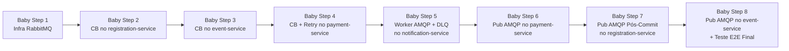

# Plano de Atualização Arquitetural em Baby Steps: Publish/Subscribe Assíncrono e Circuit Breaker

**Projeto:** EventHub — Plataforma de Gestão de Eventos Científicos e Corporativos  
**Data:** 06 de Novembro de 2026  
**Abordagem:** Evolução incremental em **8 Baby Steps autocontidos**, com garantia de **Zero-Breaking-Change** e **Gate de Validação Executável** ao final de cada passo.

---

## 1. Visão Geral e Regras de Ouro dos Baby Steps

Para evoluir a arquitetura do EventHub com **Circuit Breaker Formal (Resilience4j + PyBreaker)** e **Publish/Subscribe Assíncrono (RabbitMQ + Dead Letter Queue)** sem quebrar a implementação atual em nenhum momento:

1. **Isolamento por Passo:** Cada Baby Step altera no máximo **um serviço ou camada de infraestrutura** por vez.
2. **Sistema Sempre Executável:** Ao final de qualquer passo (do 1 ao 8), toda a aplicação continua subindo com `docker compose up -d` e passando 100% nos testes do `lab-runner.js` e `CASOS_DE_TESTE.md`.
3. **Padrão Dual-Mode (Broker-First + HTTP Fallback):** Enquanto um produtor ainda não foi migrado para AMQP, o `notification-service` continua aceitando tanto mensagens na fila RabbitMQ quanto chamadas HTTP em `POST /api/notifications/send`. E mesmo após a migração, se o RabbitMQ cair, o produtor faz fallback automático para HTTP protegido pelo Circuit Breaker.
4. **Gate Obrigatório:** Nenhum passo seguinte deve ser iniciado antes que o **Gate de Validação** do passo atual retorne sucesso.



---

## 2. Roteiro de Execução em Baby Steps

---

### 🔹 Baby Step 1 — Infraestrutura: Provisionar o RabbitMQ no Docker Compose

- **Objetivo:** Adicionar o message broker RabbitMQ na rede `eventhub-net` e parametrizar as variáveis de ambiente nos serviços, **sem tocar em nenhuma linha de código Java ou Python**.
- **Por que é autocontido e não quebra nada:** Os 6 microsserviços atuais continuam se comunicando via HTTP exatamente como hoje; apenas ganham visibilidade de rede para o novo container `eventhub-rabbitmq`.
- **Arquivos a alterar:**
  1. `docker-compose.yml`
  2. `.env.example` (e `.env` se existir localmente)

- **Alterações Exatas:**
  - Adicionar o serviço `rabbitmq` em `docker-compose.yml`:
    ```yaml
      rabbitmq:
        image: rabbitmq:3.13-management-alpine
        container_name: eventhub-rabbitmq
        restart: unless-stopped
        environment:
          RABBITMQ_DEFAULT_USER: ${RABBITMQ_USER:-eventhub}
          RABBITMQ_DEFAULT_PASS: ${RABBITMQ_PASSWORD:-eventhub_secret_2026}
        ports:
          - "${RABBITMQ_PORT:-5672}:5672"
          - "${RABBITMQ_MGMT_PORT:-15672}:15672"
        healthcheck:
          test: ["CMD", "rabbitmq-diagnostics", "-q", "ping"]
          interval: 5s
          timeout: 5s
          retries: 10
        networks:
          - eventhub-net
    ```
  - Adicionar nos blocos `environment` de `event-service`, `registration-service`, `payment-service` e `notification-service`:
    ```yaml
      RABBITMQ_HOST: rabbitmq
      RABBITMQ_PORT: 5672
      RABBITMQ_USER: ${RABBITMQ_USER:-eventhub}
      RABBITMQ_PASSWORD: ${RABBITMQ_PASSWORD:-eventhub_secret_2026}
      MESSAGING_ENABLED: ${MESSAGING_ENABLED:-true}
    ```

- **✅ Gate de Validação do Baby Step 1 (Executar antes de ir ao Passo 2):**
  1. Subir o container do broker:
     ```powershell
     docker compose up -d rabbitmq
     ```
  2. Verificar se o container está `healthy` e respondendo na API HTTP de gerenciamento:
     ```powershell
     docker inspect --format="{{.State.Health.Status}}" eventhub-rabbitmq
     curl.exe -fsS -u eventhub:eventhub_secret_2026 http://localhost:15672/api/overview
     ```
  3. **Critério de Aceite:** Status `healthy`, JSON de overview retornado na porta `15672`, e `http://localhost:8080/health` respondendo `200 OK`.
  4. **Rollback (se necessário):** `docker compose rm -sf rabbitmq` e reverter `docker-compose.yml`.

---

### 🔹 Baby Step 2 — Circuit Breaker no `registration-service` (Java / Resilience4j)

- **Objetivo:** Proteger as chamadas de saída de `ExternalIntegrationService` (`initiatePayment`, `cancelPendingPayment` e `notifyUser`) com Circuit Breaker e Retry do **Resilience4j**.
- **Por que é autocontido e não quebra nada:** As assinaturas públicas de `ExternalIntegrationService` não mudam. `RegistrationService` continua chamando os mesmos métodos e recebendo as mesmas respostas/exceções, porém com proteção contra falhas em cascata (fail-fast quando o circuito abre).
- **Arquivos a alterar:**
  1. `services/registration-service/pom.xml`
  2. `services/registration-service/src/main/resources/application.yml`
  3. `services/registration-service/src/main/java/com/eventhub/registration/service/ExternalIntegrationService.java`

- **Alterações Exatas:**
  1. Em `services/registration-service/pom.xml`, adicionar:
     ```xml
     <dependency>
         <groupId>org.springframework.boot</groupId>
         <artifactId>spring-boot-starter-aop</artifactId>
     </dependency>
     <dependency>
         <groupId>io.github.resilience4j</groupId>
         <artifactId>resilience4j-spring-boot3</artifactId>
         <version>2.2.0</version>
     </dependency>
     ```
  2. Em `services/registration-service/src/main/resources/application.yml`, adicionar:
     ```yaml
     resilience4j:
       circuitbreaker:
         instances:
           paymentServiceCB:
             slidingWindowType: COUNT_BASED
             slidingWindowSize: 6
             minimumNumberOfCalls: 3
             failureRateThreshold: 50
             waitDurationInOpenState: 10s
             permittedNumberOfCallsInHalfOpenState: 2
           notificationServiceCB:
             slidingWindowType: COUNT_BASED
             slidingWindowSize: 6
             minimumNumberOfCalls: 3
             failureRateThreshold: 50
             waitDurationInOpenState: 15s
             permittedNumberOfCallsInHalfOpenState: 2
       retry:
         instances:
           paymentServiceRetry:
             maxAttempts: 2
             waitDuration: 250ms
     ```
  3. Em `ExternalIntegrationService.java`:
     - Anotar `initiatePayment` com `@CircuitBreaker(name = "paymentServiceCB", fallbackMethod = "initiatePaymentFallback")` e `@Retry(name = "paymentServiceRetry")`. O `initiatePaymentFallback(Long registrationId, Long userId, BigDecimal amount, Throwable t)` lança `new RestClientException("CircuitBreaker paymentServiceCB ativo: " + t.getMessage(), t)`, preservando a compensação `releaseAfterPaymentFailure` em `RegistrationService.create()`.
     - Anotar `cancelPendingPayment` com `@CircuitBreaker(name = "paymentServiceCB", fallbackMethod = "cancelPendingPaymentFallback")` (fallback registra `log.warn` e não propaga).
     - Anotar `notifyUser` com `@CircuitBreaker(name = "notificationServiceCB", fallbackMethod = "notifyUserFallback")` (fallback registra `log.warn` e não propaga, preservando `RN05`).
     - Nota: Em `notifyUser`, remover o `try/catch` interno do método principal para que o aspecto do Resilience4j contabilize a falha HTTP 503/timeout, movendo a supressão da exceção para o método `notifyUserFallback`.

- **✅ Gate de Validação do Baby Step 2 (Executar antes de ir ao Passo 3):**
  1. Reconstruir e subir apenas o `registration-service`:
     ```powershell
     docker compose up -d --build registration-service
     ```
  2. Verificar saúde do serviço:
     ```powershell
     curl.exe -fsS http://localhost:8080/api/registrations/health
     ```
  3. Testar abertura do Circuit Breaker com a simulação de falha da RN05:
     - Ativar falha no `notification-service`: `POST http://localhost:8080/api/notifications/simulate-failure` com `{"fail": true}` (usando token de `ORGANIZER`).
     - Realizar/cancelar 3 inscrições e observar nos logs (`docker logs eventhub-registration-service --tail 30`) o acionamento do `notifyUserFallback` sem bloquear a inscrição (`HTTP 201` / `HTTP 200`).
     - Desativar a falha: `{"fail": false}`.
  4. **Critério de Aceite:** `registration-service` saudável, inscrições gratuitas e pagas funcionando normalmente, e fallback do Circuit Breaker registrado no log durante falha simulada.

---

### 🔹 Baby Step 3 — Circuit Breaker no `event-service` (Java / Resilience4j)

- **Objetivo:** Proteger com Circuit Breaker o envio de notificações (`NotificationClient.notifyUser`) e a chamada de cancelamento em lote de inscrições (`EventService.cancelEvent` → `registration-service`).
- **Por que é autocontido e não quebra nada:** O fallback de `cancelEvent` via `JdbcTemplate` que já existe hoje no `EventService.java` passa a ser o `fallbackMethod` formal do Circuit Breaker `registrationServiceCB`.
- **Arquivos a alterar:**
  1. `services/event-service/pom.xml`
  2. `services/event-service/src/main/resources/application.yml`
  3. `services/event-service/src/main/java/com/eventhub/event/service/NotificationClient.java`
  4. `services/event-service/src/main/java/com/eventhub/event/service/RegistrationIntegrationClient.java` (Novo componente extraído do `EventService`)
  5. `services/event-service/src/main/java/com/eventhub/event/service/EventService.java`

- **Alterações Exatas:**
  1. Adicionar `spring-boot-starter-aop` e `resilience4j-spring-boot3:2.2.0` em `services/event-service/pom.xml`.
  2. Configurar `notificationServiceCB` e `registrationServiceCB` em `services/event-service/src/main/resources/application.yml`.
  3. Em `NotificationClient.java`: anotar `notifyUser` com `@CircuitBreaker(name = "notificationServiceCB", fallbackMethod = "notifyUserFallback")` e tratar a exceção silenciosamente no fallback (RN05).
  4. Criar `RegistrationIntegrationClient.java` com o método `cancelAllByEvent(Long eventId, String authorizationHeader)` anotado com `@CircuitBreaker(name = "registrationServiceCB", fallbackMethod = "cancelAllLocalFallback")`, movendo o fallback SQL (`jdbcTemplate.update(...)`) para `cancelAllLocalFallback`.
  5. Em `EventService.java`, substituir o bloco `try/catch` manual das linhas 158–174 por `registrationIntegrationClient.cancelAllByEvent(eventId, authorizationHeader)`.

- **✅ Gate de Validação do Baby Step 3 (Executar antes de ir ao Passo 4):**
  1. Reconstruir e subir apenas o `event-service`:
     ```powershell
     docker compose up -d --build event-service
     ```
  2. Validar saúde e listagem de eventos:
     ```powershell
     curl.exe -fsS http://localhost:8080/api/events/health
     curl.exe -fsS http://localhost:8080/api/events
     ```
  3. **Critério de Aceite:** `event-service` compila sem erros, container fica `healthy`, e endpoints `/api/events` respondem `200 OK`.

---

### 🔹 Baby Step 4 — Circuit Breaker e Retry no `payment-service` (Python / PyBreaker + Tenacity)

- **Objetivo:** Proteger as duas chamadas HTTP de saída em `services/payment-service/app/services/downstream_client.py` (`notify_registration` e `send_notification`) com Circuit Breaker (`pybreaker`) e Retry exponencial curto (`tenacity`).
- **Por que é autocontido e não quebra nada:** O retorno booleano (`True`/`False`) de `DownstreamClient.notify_registration()` e `DownstreamClient.send_notification()` permanece exatamente o mesmo para o `PaymentService`.
- **Arquivos a alterar:**
  1. `services/payment-service/requirements.txt`
  2. `services/payment-service/app/services/downstream_client.py`

- **Alterações Exatas:**
  1. Em `services/payment-service/requirements.txt`, adicionar:
     ```text
     pybreaker==1.2.0
     tenacity==9.0.0
     ```
  2. Em `services/payment-service/app/services/downstream_client.py`:
     - Instanciar `registration_cb = pybreaker.CircuitBreaker(fail_max=4, reset_timeout=10, name="registration_webhook_cb")` e `notification_cb = pybreaker.CircuitBreaker(fail_max=3, reset_timeout=15, name="notification_cb")`.
     - Criar método interno `_post_with_retry(url, body)` decorado com `@retry(stop=stop_after_attempt(2), wait=wait_exponential(multiplier=0.1, min=0.1, max=0.3), reraise=True)`.
     - Em `notify_registration`: chamar `registration_cb.call(cls._post_with_retry, url, payload)` dentro de `try/except Exception` retornando `True` em sucesso e `False` caso o circuito esteja aberto (`pybreaker.CircuitBreakerError`) ou ocorra erro HTTP após as 2 tentativas.
     - Em `send_notification`: chamar `notification_cb.call(cls._post_once, url, payload)` dentro de `try/except Exception` retornando `False` silenciosamente em caso de falha ou circuito aberto (RN05).

- **✅ Gate de Validação do Baby Step 4 (Executar antes de ir ao Passo 5):**
  1. Reconstruir e subir apenas o `payment-service`:
     ```powershell
     docker compose up -d --build payment-service
     ```
  2. Validar healthcheck:
     ```powershell
     curl.exe -fsS http://localhost:8080/api/payments/health
     ```
  3. **Critério de Aceite:** Container `eventhub-payment-service` saudável (`healthy`) e fluxo de aprovação/recusa de pagamento operando sem regressão.

---

### 🔹 Baby Step 5 — Consumidor Assíncrono AMQP + DLQ no `notification-service` (Python / FastAPI)

- **Objetivo:** Tornar o `notification-service` capaz de consumir eventos da fila RabbitMQ `eventhub.notifications.queue` em background, encaminhando falhas simuladas (RN05) para a Dead Letter Queue `eventhub.notifications.dlq`, **mantendo o endpoint REST `POST /api/notifications/send` 100% ativo**.
- **Por que é autocontido e não quebra nada:** Nenhum produtor foi alterado ainda. O `notification-service` passa a escutar a fila em paralelo ao servidor HTTP FastAPI.
- **Arquivos a alterar:**
  1. `services/notification-service/requirements.txt`
  2. `services/notification-service/app/config/settings.py`
  3. `services/notification-service/app/services/amqp_consumer.py` (Novo arquivo)
  4. `services/notification-service/app/main.py`

- **Alterações Exatas:**
  1. Em `services/notification-service/requirements.txt`, adicionar `aio-pika==9.4.3`.
  2. Em `services/notification-service/app/config/settings.py`, adicionar:
     ```python
     rabbitmq_host: str = os.getenv("RABBITMQ_HOST", "rabbitmq")
     rabbitmq_port: int = int(os.getenv("RABBITMQ_PORT", "5672"))
     rabbitmq_user: str = os.getenv("RABBITMQ_USER", "eventhub")
     rabbitmq_password: str = os.getenv("RABBITMQ_PASSWORD", "eventhub_secret_2026")
     messaging_enabled: bool = os.getenv("MESSAGING_ENABLED", "true").lower() == "true"

     @property
     def amqp_url(self) -> str:
         return f"amqp://{self.rabbitmq_user}:{self.rabbitmq_password}@{self.rabbitmq_host}:{self.rabbitmq_port}/"
     ```
  3. Criar `services/notification-service/app/services/amqp_consumer.py`:
     - Conectar com `aio_pika.connect_robust(settings.amqp_url)`.
     - Declarar:
       - Exchange principal: `eventhub.domain.events` (`ExchangeType.TOPIC`, `durable=True`)
       - Dead Letter Exchange: `eventhub.domain.dlx` (`ExchangeType.TOPIC`, `durable=True`)
       - Dead Letter Queue: `eventhub.notifications.dlq` (`durable=True`, bind em `eventhub.domain.dlx` com routing key `#`)
       - Fila principal: `eventhub.notifications.queue` (`durable=True`, com argumentos `{"x-dead-letter-exchange": "eventhub.domain.dlx"}` e bind em `eventhub.domain.events` com routing key `notification.#`)
     - No callback de consumo da mensagem:
       - Ler o JSON (aceitando tanto formato com envelope `{"payload": {...}}` quanto payload direto `{"userId": ..., "recipientEmail": ..., "eventType": ..., "message": ...}`).
       - Se `NotificationService.get_failure_state()` for `True`, rejeitar a mensagem com `await message.reject(requeue=False)` para enviá-la à DLQ `eventhub.notifications.dlq`.
       - Caso contrário, abrir `SessionLocal()`, chamar `NotificationService(db).send_notification(NotificationSendRequest(**payload_data))` e fazer `ack`.
  4. Em `services/notification-service/app/main.py`, registrar o `lifespan` do FastAPI para iniciar a task do consumidor na subida e encerrá-la graciosamente no shutdown.

- **✅ Gate de Validação do Baby Step 5 (Executar antes de ir ao Passo 6):**
  1. Reconstruir e subir o `notification-service`:
     ```powershell
     docker compose up -d --build notification-service
     ```
  2. Verificar na API do RabbitMQ se a exchange e as duas filas (`eventhub.notifications.queue` e `eventhub.notifications.dlq`) foram criadas automaticamente:
     ```powershell
     curl.exe -fsS -u eventhub:eventhub_secret_2026 http://localhost:15672/api/queues
     ```
  3. Publicar uma mensagem de teste diretamente via API do RabbitMQ e verificar se ela foi consumida e persistida no banco pelo `notification-service`:
     ```powershell
     curl.exe -fsS -u eventhub:eventhub_secret_2026 -H "Content-Type: application/json" -X POST http://localhost:15672/api/exchanges/%2F/eventhub.domain.events/publish -d "{\"properties\":{},\"routing_key\":\"notification.test\",\"payload\":\"{\\\"userId\\\":3,\\\"recipientEmail\\\":\\\"participante1@eventhub.com\\\",\\\"eventType\\\":\\\"AMQP_SMOKE_TEST\\\",\\\"message\\\":\\\"Teste PubSub RabbitMQ\\\"}\",\"payload_encoding\":\"string\"}"
     ```
  4. **Critério de Aceite:** `routed: true` no RabbitMQ e nova notificação `AMQP_SMOKE_TEST` visível no histórico do usuário `3`.

---

### 🔹 Baby Step 6 — Publicador Assíncrono Dual-Mode no `payment-service` (Python / Pika)

- **Objetivo:** Fazer o `payment-service` publicar os eventos de pagamento (`PAYMENT_APPROVED`, `PAYMENT_REFUSED`, `PAYMENT_EXPIRED`) na exchange `eventhub.domain.events` do RabbitMQ, mantendo fallback automático para HTTP + Circuit Breaker caso o broker esteja inacessível ou caso a simulação de falha síncrona precise ser testada.
- **Por que é autocontido e não quebra nada:** Altera apenas o método `DownstreamClient.send_notification` dentro do `payment-service`.
- **Arquivos a alterar:**
  1. `services/payment-service/requirements.txt`
  2. `services/payment-service/app/config/settings.py`
  3. `services/payment-service/app/services/downstream_client.py`

- **Alterações Exatas:**
  1. Adicionar `pika==1.3.2` em `services/payment-service/requirements.txt`.
  2. Adicionar configurações `rabbitmq_host`, `rabbitmq_port`, `rabbitmq_user`, `rabbitmq_password` e `messaging_enabled` em `services/payment-service/app/config/settings.py`.
  3. Em `DownstreamClient.send_notification`:
     - Se `settings.messaging_enabled` for `True`: publicar JSON na exchange `eventhub.domain.events` com routing key `f"notification.payment.{event_type.lower()}"` e `delivery_mode=2` (persistente), usando timeout de socket de `1.0s`.
     - Se a publicação AMQP falhar por qualquer motivo de conexão, cair automaticamente no envio HTTP protegido pelo `notification_cb` implementado no Baby Step 4.

- **✅ Gate de Validação do Baby Step 6 (Executar antes de ir ao Passo 7):**
  1. Reconstruir e subir o `payment-service`:
     ```powershell
     docker compose up -d --build payment-service
     ```
  2. Criar uma inscrição em atividade paga, confirmar o pagamento (`POST /api/payments/{id}/confirm`) e verificar nos logs do `notification-service` que a notificação `PAYMENT_APPROVED` foi recebida via consumidor AMQP.
  3. **Critério de Aceite:** Pagamento aprovado com `HTTP 200`, inscrição muda para `CONFIRMED` e notificação `PAYMENT_APPROVED` é gravada via fila RabbitMQ.

---

### 🔹 Baby Step 7 — Publicador Assíncrono Pós-Commit no `registration-service` (Java / Spring AMQP)

- **Objetivo:** Fazer o `registration-service` publicar notificações (`REGISTRATION_CONFIRMED`, `REGISTRATION_PENDING_PAYMENT`, `REGISTRATION_WAITLIST`, `REGISTRATION_CANCELLED`, `WAITLIST_PROMOTED`) no RabbitMQ **após o commit da transação (`AFTER_COMMIT`)**, liberando imediatamente o lock pessimista do PostgreSQL e mantendo fallback HTTP protegido pelo Resilience4j.
- **Por que é autocontido e não quebra nada:** A assinatura `external.notifyUser(userId, eventType, message)` continua existindo, mas agora publica um evento de aplicação do Spring que é processado em `TransactionPhase.AFTER_COMMIT` via RabbitMQ (com fallback HTTP).
- **Arquivos a alterar:**
  1. `services/registration-service/pom.xml`
  2. `services/registration-service/src/main/resources/application.yml`
  3. `services/registration-service/src/main/java/com/eventhub/registration/config/RabbitMqConfig.java` (Novo arquivo)
  4. `services/registration-service/src/main/java/com/eventhub/registration/service/ExternalIntegrationService.java`

- **Alterações Exatas:**
  1. Adicionar `spring-boot-starter-amqp` em `services/registration-service/pom.xml`.
  2. Configurar `spring.rabbitmq.*` e `eventhub.messaging.enabled: ${MESSAGING_ENABLED:true}` em `services/registration-service/src/main/resources/application.yml`.
  3. Criar `RabbitMqConfig.java` com `TopicExchange("eventhub.domain.events", true, false)` e `Jackson2JsonMessageConverter`.
  4. Em `ExternalIntegrationService.java`:
     - Ao chamar `notifyUser(userId, eventType, message)`: se houver transação ativa (`TransactionSynchronizationManager.isActualTransactionActive()`), registrar sincronização `afterCommit` (ou `@TransactionalEventListener(phase = TransactionPhase.AFTER_COMMIT, fallbackExecution = true)`) para que o I/O ocorra fora do lock pessimista `SELECT ... FOR UPDATE`.
     - No envio: publicar na exchange `eventhub.domain.events` com routing key `notification.registration.<tipo>` via `RabbitTemplate`. Caso `messagingEnabled` seja `false` ou o `RabbitTemplate` lance exceção, acionar o envio HTTP protegido pelo `@CircuitBreaker(name = "notificationServiceCB")`.

- **✅ Gate de Validação do Baby Step 7 (Executar antes de ir ao Passo 8):**
  1. Reconstruir e subir o `registration-service`:
     ```powershell
     docker compose up -d --build registration-service
     ```
  2. Realizar uma inscrição gratuita e um cancelamento de inscrição.
  3. Verificar nos logs de `eventhub-registration-service` e `eventhub-notification-service` que o evento foi publicado no RabbitMQ após o commit e persistido na tabela `notifications`.
  4. **Critério de Aceite:** Inscrição, fila de espera e cancelamento funcionando com `HTTP 201`/`200` e notificações entregues via RabbitMQ.

---

### 🔹 Baby Step 8 — Publicador Assíncrono no `event-service` e Validação End-to-End Final

- **Objetivo:** Migrar o `NotificationClient` do `event-service` (`EVENT_UPDATED`, `EVENT_CANCELLED`, `ACTIVITY_UPDATED`, `CERTIFICATE_ISSUED`) para publicar no RabbitMQ com fallback HTTP + Circuit Breaker, eliminando o gargalo de loops HTTP síncronos ao atualizar/cancelar eventos.
- **Por que é autocontido e não quebra nada:** Mantém a mesma assinatura `notificationClient.notifyUser(userId, eventType, message)` consumida por `EventService`, `ActivityService` e `CertificateService`.
- **Arquivos a alterar:**
  1. `services/event-service/pom.xml`
  2. `services/event-service/src/main/resources/application.yml`
  3. `services/event-service/src/main/java/com/eventhub/event/config/RabbitMqConfig.java` (Novo arquivo)
  4. `services/event-service/src/main/java/com/eventhub/event/service/NotificationClient.java`

- **Alterações Exatas:**
  1. Adicionar `spring-boot-starter-amqp` em `services/event-service/pom.xml`.
  2. Configurar `spring.rabbitmq.*` e `eventhub.messaging.enabled: ${MESSAGING_ENABLED:true}` em `services/event-service/src/main/resources/application.yml`.
  3. Criar `RabbitMqConfig.java` declarando `TopicExchange("eventhub.domain.events", true, false)` e `Jackson2JsonMessageConverter`.
  4. Em `NotificationClient.java`: publicar via `RabbitTemplate` na exchange `eventhub.domain.events` com routing key `notification.event.<tipo>`; em caso de indisponibilidade do broker, acionar o fallback HTTP protegido pelo `@CircuitBreaker(name = "notificationServiceCB")`.

- **✅ Gate de Validação Final do Baby Step 8 (Bateria de Regressão Completa):**
  1. Reconstruir o `event-service` e verificar se todos os 8 containers estão `healthy`:
     ```powershell
     docker compose up -d --build event-service
     docker compose ps
     ```
  2. **Teste 1 — Fluxo Normal Pub/Sub:**
     - Editar uma atividade ou emitir um certificado e confirmar que a notificação aparece imediatamente para o participante, processada via fila `eventhub.notifications.queue`.
  3. **Teste 2 — Resiliência com Simulação de Falha + DLQ (RN05 / RQ03):**
     - Ativar modo de falha (`POST /api/notifications/simulate-failure` com `{"fail": true}`).
     - Realizar nova inscrição: confirmar que a inscrição retorna `HTTP 201` imediatamente e que a mensagem foi retida na fila `eventhub.notifications.dlq` do RabbitMQ (`messages: 1`), sem perda de evento.
     - Desativar modo de falha (`{"fail": false}`).
  4. **Teste 3 — Fallback de Circuit Breaker com Broker Pausado:**
     - Pausar o RabbitMQ (`docker compose pause rabbitmq`), realizar uma inscrição e confirmar que o fallback HTTP + Circuit Breaker assume sem erro para o usuário; despausar em seguida (`docker compose unpause rabbitmq`).
  5. **Teste 4 — Regressão Completa da Interface (`web-app`):**
     - Executar a suíte automatizada do laboratório em `http://localhost:8080` (`lab-runner.js`) e confirmar 100% dos testes aprovados.

---

## 3. Tabela-Resumo de Controle de Execução (Checklist de Baby Steps)

| Passo | Escopo Isolado | Serviços Rebuildados | Risco de Regressão | Como Validar Rapidamente | Status |
|---|---|---|---|---|---|
| **Baby Step 1** | Container RabbitMQ + Variáveis de Ambiente | `rabbitmq` | **Zero** (sem mudança de código) | `GET http://localhost:15672/api/overview` | ✅ Concluído |
| **Baby Step 2** | Circuit Breaker (Resilience4j) no `registration-service` | `registration-service` | **Muito Baixo** | `GET /api/registrations/health` + inscrição com `simulateFailure=true` | ✅ Concluído |
| **Baby Step 3** | Circuit Breaker (Resilience4j) no `event-service` | `event-service` | **Muito Baixo** | `GET /api/events/health` + `GET /api/events` | ✅ Concluído |
| **Baby Step 4** | Circuit Breaker (`pybreaker`) + Retry (`tenacity`) no `payment-service` | `payment-service` | **Muito Baixo** | `GET /api/payments/health` + confirmação de pagamento | ✅ Concluído |
| **Baby Step 5** | Consumidor AMQP (`aio-pika`) + DLQ no `notification-service` | `notification-service` | **Zero** (REST `/send` intocado) | `GET :15672/api/queues` + publish de teste na exchange | ✅ Concluído |
| **Baby Step 6** | Publicador AMQP Dual-Mode no `payment-service` | `payment-service` | **Baixo** (possui fallback HTTP) | Aprovar pagamento e checar consumo AMQP nos logs | ✅ Concluído |
| **Baby Step 7** | Publicador AMQP `AFTER_COMMIT` Dual-Mode no `registration-service` | `registration-service` | **Baixo** (possui fallback HTTP) | Criar/cancelar inscrição e checar consumo AMQP nos logs | ✅ Concluído |
| **Baby Step 8** | Publicador AMQP Dual-Mode no `event-service` + Regressão E2E | `event-service` | **Baixo** (possui fallback HTTP) | Emitir certificado / atualizar evento + rodar `lab-runner.js` | ✅ Concluído |

